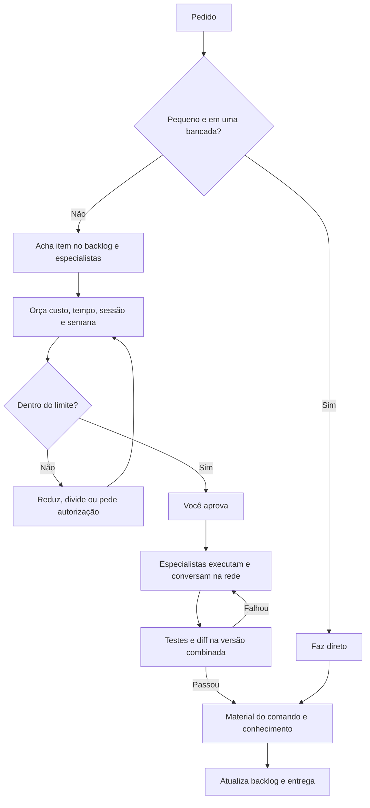

# Fluxo de execução do Fenkra

Siga estas etapas junto com a skill `maestro`. O painel mostra em qual etapa você está.



Comece a orquestração e mostre as etapas:

```bash
python ~/.claude/skills/maestro/scripts/maestro.py new "<titulo>" --project Fenkra --why "<id do backlog>"
python ~/.claude/skills/maestro/scripts/maestro.py fluxo "Pedido|Especialistas|Orçamento|Aprovação|Execução|Verificação|Material|Entrega"
python ~/.claude/skills/maestro/scripts/maestro.py up --open
```

Ao mudar de etapa: `maestro.py etapa "<nome>"`.

## 1. Pedido e especialistas

Ache o item com `backlog list --project Fenkra` e veja reportes abertos no cofre JV. Sem item, crie um
com `backlog add`. Escolha as bancadas pelos arquivos afetados:

| Pedido | Especialistas |
|---|---|
| Ícone, tooltip, tema, navegação | `interface` |
| Dobra, aba, planificação | `chapa`, com `solidos` se mexer em feature |
| Restrição, junta, peça no contexto | `montagem`, com `plm` se mexer em links |
| Perfil, solda, lista de corte | `estrutural`, com `desenho` se mudar balões |
| Sketch e solver | `sketch` |
| Falha do OpenCASCADE, tolerância | `kernel` e a bancada do sintoma |

Se faltar conhecimento, leia `Conhecimento/<bancada>` antes de pesquisar. Item de pesquisa aberto para
aquela bancada entra como primeira onda quando a tarefa depender dele.

## 2. Orçamento e aprovação

Leia a cota, rode `backlog orcamento <ids> --project Fenkra`, diga à pessoa custo, tempo e consumo de
sessão e semana, e espere o sim. Aprovação vale só para esse escopo.

## 3. Execução

Registre cada agente com `--item <id>`. Em paralelo só com arquivos separados:
`fenkra-solidos/src/lib.rs`, `fenkra-app/src/app.rs` e `i18n.rs` são gargalos, então coordene em ondas
ou com `isolation: "worktree"`.

## 4. Verificação

Rode `cargo test` nos crates afetados, leia o diff e use `FENKRA_DEMO*` para mudança visual. Falhou:
corrija antes de seguir; não avance com teste quebrado.

## 5. Material

Para cada comando criado ou alterado, escreva a nota em `Comandos/` no cofre, com `Templates/Comando.md`.
Guarde aprendizados técnicos em `Conhecimento/<bancada>`, promova regras à skill da bancada e registre
fontes em `docs/arquitetura/procedencia.md`.

## 6. Entrega

Atualize o estado: item M pelo `backlog set`; item B pelo `scripts/benchmark/backlog.py`, regenerando
com `python -I scripts/benchmark/backlog.py`. Reporte resolvido segue a regra do cofre JV. Entregue o
que mudou, o que foi testado, o custo real, o link do material e o que falta. Commit só com pedido.
