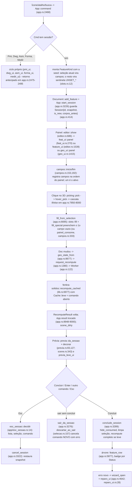
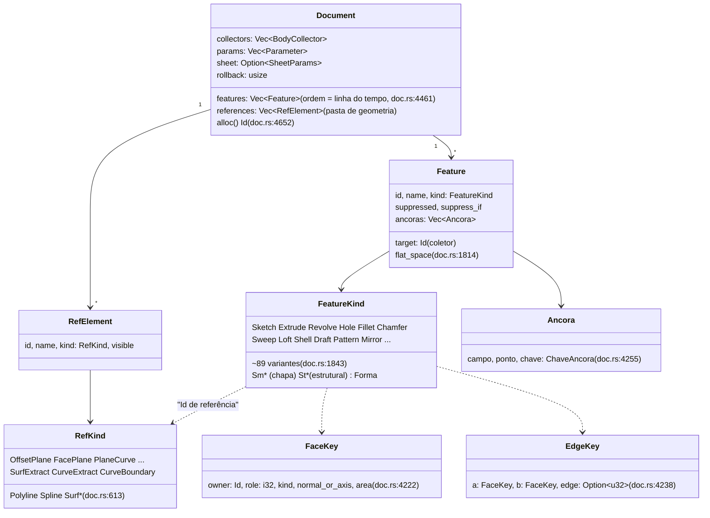
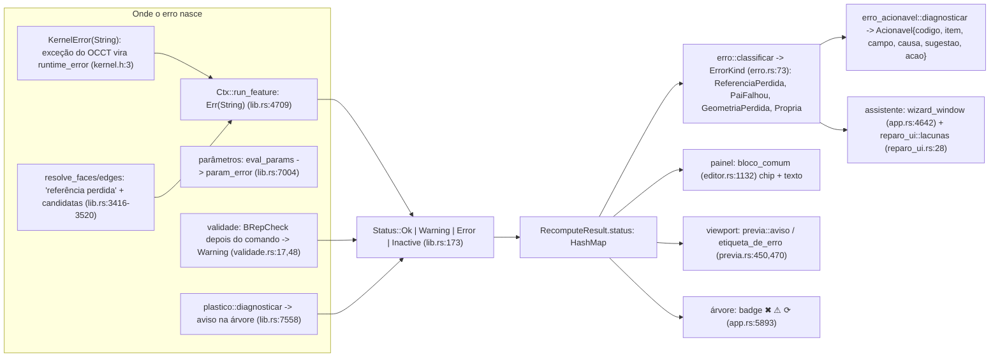
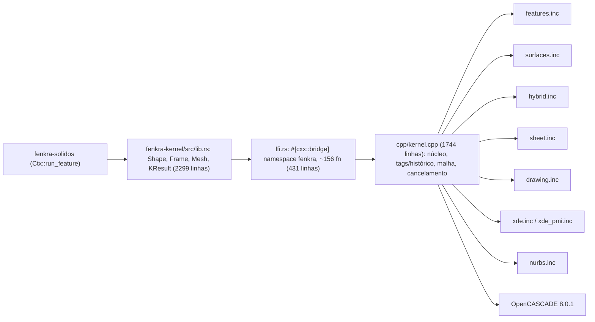

# Motor transversal dos comandos (B565)

Levantamento de 21/11/2026, só de leitura do código (`develop` depois da alpha.41). Descreve o que todo
comando atravessa hoje, com arquivo e linha, para sustentar o **contrato único de feature** da última
seção. Complementa [selecao-auditoria.md](../../benchmark/detalhe/selecao-auditoria.md), que já lista os
campos de seleção por bancada, e o checklist de [interface.md](../../benchmark/detalhe/interface.md).

Convenções: `arquivo:linha` é a linha onde a definição começa na `develop` de 21/11/2026 e muda a cada
edição; a função citada é a âncora estável. Onde algo não foi lido por inteiro, o texto diz.

ADRs que governam este assunto: [0010](../adr/0010-referencias-v2.md) (referências v2),
[0017](../adr/0017-previa-fantasma-sobre-o-recalculo.md) (prévia fantasma),
[0021](../adr/0021-ajustes-de-comando-em-struct-proprio.md) (campos novos em struct própria),
[0030](../adr/0030-fila-de-trabalho-cancelavel.md) (fila cancelável),
[0032](../adr/0032-conjunto-unico-de-selecao.md) (seleção única),
[0073](../adr/0073-rosca-em-trechos-e-previa-leve.md) e [0075](../adr/0075-previa-leve-dos-comandos-pesados.md)
(prévia leve), [0094](../adr/0094-coluna-esquerda-e-paineis-que-reservam-espaco.md),
[0104](../adr/0104-barras-soltas-paineis-redimensionaveis-e-arvore-transparente.md) e
[0105](../adr/0105-painel-do-comando-e-reparo-flutuam-ou-encaixam.md) (painéis).

---

## 1. Ciclo de vida de um comando



### 1.1 Abertura (`App::command`)

- `Cmd` (app.rs:8300) é um enum de comandos de toolbar, **não** o `FeatureKind`. Vários `Cmd` viram o mesmo
  `FeatureKind` com ajustes diferentes (Extrude, ExtrudeMid, ExtrudeUpTo, Cut, CutBlind, CutUpTo; quatro Hole).
- Antes do ramo comum, cinco famílias saem por ciclo próprio: `Pmi` (`pmi_ui::command`), `Dwg`
  (`dwg_ui::command`), montagem (`asm_ui::command`), `Forma` (`forma_ui::comecar`) e `Medir`
  (`medir_ui::abrir`). Elas não têm `Session`, então não passam por Concluir/Cancelar, "preso" nem prévia
  fantasma (app.rs:2475-2495).
- O ramo comum recolhe o que já estava escolhido: `picked_edges/faces/keys` (app.rs:2270-2310),
  `faces_com_regra` (selecao_regras) e `seed(true)` (app.rs:2346) para curvas, pontos, planos e superfície.
  Campo que não achou o que escolher nasce com um **id sentinela por tipo** (`UNSET_POINT`, `UNSET_CURVE`,
  `UNSET_PLANE`, `UNSET_SURF`, `UNSET_AXIS`, `UNSET_SKETCH`, slots.rs:12-17).
- A cadeia tangente do `command` só vale para três tipos de geometria (`SurfFill`, `OpJoin`, `CurveJoin`),
  no instante da abertura (`App::chained`, app.rs:2312, chamado em app.rs:2517).
- `start_session` (app.rs:3226) fixa `snapshot` do documento inteiro e `corpos_antes` (a malha antes do
  comando, que fica sob a prévia quando o comando refaz o corpo). Se o comando é "pesado" ou rosca modelada,
  já pede o recompute leve (em `start_session`).

### 1.2 Painel e campo ativo

Três famílias de painel, escolhidas por `editor::show_painel` (editor.rs:703):

| Painel | Para | Onde |
|---|---|---|
| `feat_ui::panel` | Sólidos, Chapa e superfície-sólido; devolve `true` quando tratou o tipo (editor.rs:1552) | feat_ui.rs:270 |
| `editor::feature_ui` | o resto de `FeatureKind` (Sketch, Extrusão, Revolução, Furo, Filete/Chanfro...) | editor.rs:1539 |
| `geo_ui::panel` | Superfícies e wireframe (`RefKind`, tipo diferente de `FeatureKind`) | geo_ui.rs:1415 |
| `st_*_ui.rs`, `chapa_*_ui.rs`, `asm_ui.rs` | Estrutural, Chapa especializada, Montagem | vários |

`bloco_comum` (editor.rs:1132) desenha o cabeçalho de todo comando: ícone, nome, chip de status
(`ERRO`, `AVISO`, `A ESCOLHER`, `INATIVO`, `OK`), a mensagem do status e `suprimido` / `suprimir_se`.

**Campo ativo.** Três mecanismos precisam concordar:

1. `campos.rs` (B514): cada widget de seleção chama `selecao_campo` (campos.rs:234) e entra no registro da
   ordem de desenho do quadro. Primeiro campo vazio é o ativo; Tab/Shift+Tab/Enter avançam
   (`enter_avanca`, campos.rs:338); `painel_consome` (campos.rs:333) diz se o painel usa o clique em vez do
   `App`.
2. `entradas::campo_ativo` (entradas.rs:99): devolve o tipo esperado (`Espera`: Perfil, Eixo, Face, Aresta,
   Corpo, Plano, Ponto, Curva, Superficie, entradas.rs:14) para destacar no 3D e preencher a "faixa" do
   painel. Tem um `match` por `FeatureKind` para os comandos cuja entrada vazia **não** é um sentinela
   (Shell, Draft, Thickness, DirectEdit, Thread, SmBend, SmJoggle, SmLouver, SmCurveFlange, SmFlangeLoop,
   Fillet/Chamfer); para os demais cai em `slots::vazios_em_ordem`.
3. `slots::fill` (slots.rs:288) e `fill_special` (slots.rs:303): quem de fato escreve o clique no comando.

### 1.3 Clique no 3D

- `picking.rs`: `pick` (255), `plano_primeiro` (297), `pick_com_caixas` (402), `pilha_de_faces` (608),
  `box_select`/`laco_select` (646/651), `edge_polyline` (864), `tangent_chain` (803). `Filter` (picking.rs:57)
  carrega o que pode ser escolhido. `Pick` (picking.rs:12) é o resultado: Face, Edge, Vertex, Plane, Geo, SkCurve...
- O filtro vem da barra **ou** do comando aberto: `selecao::tipos_do_comando` (selecao.rs:185) só conhece
  `wants_faces` e Filete/Chanfro com arestas; qualquer outro comando usa o filtro da barra (app.rs:7807).
  A prévia fantasma tira do clique as faces do próprio comando (`Filter::fantasma`, ADR 0017), salvo nos
  comandos que escolhem faces (`escolhe_faces`).
- **Cascata de cliques** em app.rs:7850-8000. Cada ramo `else if` trata um tipo de comando aberto antes do
  clique genérico: pincel, região de corte (`sup3d::alternar_regiao`), laço de abas (`face_clicada_na_aba`),
  faces (`face_cmd` -> `feat_ui::toggle_face`), corpo ferramenta (`entradas::clique_no_corpo`), aresta da aba
  (`slots::aresta_clicada`), spline por pontos (`sup_spline`), duplo clique (abrir dono), Filete/Chanfro
  (`edge_cmd`, com arestas e com face -> arestas do contorno), e por último `clique_no_3d` (app.rs:3437), que
  aplica `selecao::aplicar` (selecao.rs:98) ao conjunto `picks`.
- Depois da cascata, em app.rs:9525-9545, o `picks` restante preenche campos vazios via `fill_from_selection`
  (ou o painel consome). Item clicado na árvore passa pelo mesmo `fill_from_selection(sid, Some(sel))`; se não
  preenche nada, `coluna::arvore_pela_seta` mantém o comando aberto, senão `sair_da_sessao` conclui.
- **Seleção em caixa e laço**: app.rs:8000-8060, `picking::box_select`/`laco_select`, que compartilham
  `selecionar_regiao` (picking.rs:659). Janela (esquerda para direita) e cruzada (direita para esquerda).
- **Caixa de seleção de lista** (B555): `caixa_selecao.rs`. `Marcas` (16) guarda os marcados;
  `geo_ui::bag` (geo_ui.rs:1052) desenha; `publicar_realce`/`desenhar_realce` acendem no 3D.

### 1.4 Prévia

Dois mecanismos que coexistem:

- **Fantasma sobre o recompute completo** (ADR 0017): o comando aberto já está no documento; o worker
  recalcula com cache; `previa.rs` só muda como o resultado aparece. `Scene::ghost` recebe as faces cujo dono
  é o comando (`previa::decorar`, previa.rs:127; `scene.rs:343`). Se falha, `App.result` não troca (a tela
  mantém o último resultado) e a etiqueta de erro vem do status (`previa::aviso`, previa.rs:450;
  `etiqueta_de_erro`, previa.rs:470). `Session::ultima_valida` guarda a última prévia aceita.
- **Prévia leve** (ADR 0073, 0075): com `Cache::leve = Some(id)` (lib.rs:1094), `run_feature`
  (lib.rs:4709) chama `Ctx::previa_leve` (previa_leve.rs:215) antes do cálculo real e devolve só
  `PreviaViz` (arestas, caixas, pares). Quem cobre: `previa_leve::cobre` (previa_leve.rs:44): Filete,
  Chanfro, Casca, Padrão, Espelho, Varredura, Loft e os "só no fim" (`so_no_fim`, previa_leve.rs:66):
  quinze comandos de Chapa e quatro Estruturais, apenas quando são o último comando ativo (`cobre_no`,
  previa_leve.rs:102). `por_dentro` (previa_leve.rs:96) cobre Aba, Bainha e Dobra: o comando roda de verdade
  mas sem colisão nem booleana. O desenho das linhas leves está em `previa_leve_ui.rs`. O resultado leve
  **nunca vira o final**: a assinatura ganha a marca `"leve"` (lib.rs:7122) e o corpo recebe uma assinatura
  derivada (lib.rs:7312), então o cache não confunde.
- **Rótulos e alças por comando** moram em `previa::rotulos` (previa.rs:485), um `match` por `FeatureKind`
  (rosca, varredura...), e em `handles.rs`/`handles/*.rs` (alças). `checklist_comandos.rs` mede quais comandos
  têm alça.
- Prévia sem entrada: comando com campo ainda `a_escolher` fica **Inactive** sem erro (B459, lib.rs:7256),
  então a prévia espera.

### 1.5 Concluir, cancelar, preso, Esc

- **Enter** (app.rs:9110-9118): `Ctrl+Enter` = aplicar e continuar (`continuar::aplicar_e_continuar`,
  continuar.rs:59); Enter simples = `conclude_session`, salvo se `campos::enter_avanca` (há campo de seleção
  adiante). **Esc** desfaz um nível por vez (`esc_sessao::decidir`).
- **conclude_session** (app.rs:3289): reabre se preso (`reabrir_se_preso`), descarta membro estrutural sem linha
  (`membro_sem_linhas`), limpa a seleção, `hide_consumed` (entradas consumidas somem), `split_struct_member`,
  e **força um recompute sem `leve`** (app.rs:3310) para o resultado final ser o completo.
- **cancel_session** (app.rs:3322) restaura o `snapshot` inteiro (cópia do documento) e pede novo recompute.
- **Duplo clique no ícone** (B554, `preso.rs`): `Preso(Option<Alvo>)` com `Alvo::Cmd` (sessão) e `Alvo::Sk`
  (ferramentas do sketch). `App::prender` (app.rs:3366) só prende comando com sessão; reabertura em
  `reabrir_preso_no_quadro` (app.rs:3393) no começo do quadro seguinte. Duplo clique numa face na viewport
  abre o comando que a criou (`open_pending`, app.rs:7934).

### 1.6 Layout do painel

`app/coluna.rs` (ADR 0094/0105): sem comando a coluna esquerda mostra a árvore; com comando, o painel do
comando toma a coluna e a árvore recolhe em uma seta (`arvore_pela_seta`). `Opcoes::flutua` deixa o painel do
comando e o assistente de reparo flutuarem. `paineis.rs` e `barras_layout.rs` guardam posição e tamanho.

---

## 2. Documento e referências



### 2.1 Duas listas, dois tipos

- **`Document::features`** (linha do tempo, doc.rs:4461 em diante): o vetor **é** a ordem de recálculo. Sketches
  livres (`is_free`, doc.rs:4728, na pasta de Geometria) são calculados **antes** dos comandos dos coletores
  (lib.rs:7044). `rollback` é o marcador geral; `BodyCollector::marker` o marcador por coletor
  (`is_active`, doc.rs:4733).
- **`Document::references`**: geometria de referência (planos, pontos, curvas, superfícies, extrações). Não é
  `FeatureKind`: é `RefElement{kind: RefKind}`. É avaliada **sob demanda** (`Ctx::geo`, lib.rs:2183, com
  memo e profundidade máxima 24) quando uma feature a cita, e de novo, depois da linha do tempo, em um laço
  próprio (lib.rs:7358-7430) com cache próprio (`Cache::refs`). Por isso a bancada de Superfícies tem
  painel e ciclo de cache diferentes dos Sólidos (a auditoria já nota: `geo_ui` x `feat_ui`).
- **`Feature::target`** aponta o `BodyCollector` onde o resultado entra (`Ctx::bodies: HashMap<Id, Body>`).
  `Body = (Shape, Vec<Id> donos, Vec<i32> papéis)` (lib.rs:224): para cada face do corpo guardam-se o
  comando que a criou e o papel dela.

### 2.2 Como uma feature aponta para outra

Todo vínculo é um `Id` dentro do `FeatureKind` ou de um `*Ref`. Os tipos de referência (doc.rs):

| Tipo | Variantes relevantes |
|---|---|
| `PlaneRef` (56) | `Origin`, `Datum(Id)` |
| `AxisRef` (69) | `Origin`, `SketchLine`, `Ref`, `Fixed`, `Face{point,key}`, `Edge{mid,key}`, `Planes` |
| `PointRef` (108) | `Origin`, `Ref`, `Fixed`, `SketchPoint`, `CurveVertex`, `Vertex{point,edge}`, `Center{point,edge}`, `OnFace{point,key}` |
| `CurveRef` (146) | `Axis`, `Ref`, `SketchLine`, `Edge(pts)`, `BodyEdge{pts,key}`, `SketchCurve`, `Segment` |
| `SurfRef` (229) | `Plane`, `Face{point,normal,owner,key}`, `Ref` |

- Perfil por **sketch inteiro**: `Extrude.sketch: Id`, `Loft.sections: Vec<Id>` (doc.rs:4067, 3794). É por isso
  que nenhum comando de perfil aceita curvas de sketches diferentes (auditoria, "Achados B561" item 1).
- `Document::refs_of` (doc.rs:5333) e `FeatureKind::walk` (doc.rs:3322) percorrem todos os `Id` citados; é a
  única fonte de dependência usada pelo recompute (assinatura), por `dependents` (doc.rs:5463, para apagar) e
  por `erro::pais` (erro.rs:50).
- `Document::delete(id, with_dependents)` (doc.rs:5531) apaga o grupo e devolve a exibição das entradas que
  ele consumia (`consumed`/`hide_consumed`, doc.rs:5426).

### 2.3 Referências v2 (ADR 0010, B516)

Face, aresta e vértice escolhidos no 3D não guardam só o ponto. A resolução é em camadas, a cada
recompute, em `refs::find_face` / `find_edge` (refs.rs:205, 225):

1. **dono**: o comando que gerou a face (`BodyResult.face_owner`);
2. **papel**: o que a face é para o dono (`face_role`: 0 tampa inicial, 1 final, 2+i lateral da aresta i do
   perfil, -1 desconhecido; `PAPEL_SUPERFICIE + i` para superfícies, doc.rs:4252);
3. **assinatura geométrica**: tipo (`kind` 0 plano, 1 cilindro, 2 outro), normal ou eixo, área;
4. **ponto clicado**: só reserva e compatibilidade.

`EdgeKey` é o par de `FaceKey` vizinhas (mais o índice da aresta em superfícies, B515). Se a consulta não dá
exatamente uma entidade, o comando vai a **erro com sugestão**, nunca escolhe em silêncio
(`Ctx::resolve_faces`, lib.rs:3440; `resolve_edges`, lib.rs:3483; `lost`, lib.rs:3416).

Os papéis nascem no kernel ou por geometria: `extrude_roles`/`revolve_roles`
(fenkra-kernel/src/lib.rs:517, 527), `boolean_tagged_src` (kernel lib.rs:618) e `papeis.rs`
(`por_perfil` 46, `papeis_topo` 173, `furos` 229, `aba_topo` 291). `Ctx::apply_roles` (lib.rs:4604) leva os
papéis da ferramenta para o corpo.

**Cinco jeitos de guardar a chave**, porque o ADR 0010 foi aplicado em fases:

| Jeito | Exemplos |
|---|---|
| Listas paralelas ao ponto | `EdgeOp.keys`, `Shell.face_keys`, `Draft.face_keys` (doc.rs:4323, 3891) |
| Campo `*_key: Option<...>` ao lado do ponto | `SmFlange.edge_key`, `Thread.face_key` |
| Chave **dentro** do tipo de referência | `CurveRef::BodyEdge`, `AxisRef::Face{key}`, `PointRef::Vertex/Center/OnFace`, `SurfRef::Face{key}` |
| `Feature::ancoras: Vec<Ancora>` (B516) | campos só-ponto das chapas e estruturais; `Ancora::de(campo, p)` só vale para o ponto em que nasceu (doc.rs:4255) |
| `RefKind::FacePlane{key}`, `SurfExtract{key}` | referências da pasta de geometria |

Promoção: o recompute descobre chaves para pontos antigos e devolve `RecomputeResult.promoted:
HashMap<Id, Promoted>` (lib.rs:778); o `App` grava no documento (`apply_promoted`, app.rs:2093). `Promoted` tem
sete variantes (Edges, Faces, Furo, Ancoras, Ate, Caminhos, Referencia). Só vale se `g == self.gen_sent` (app.rs:8957).

### 2.4 Ordem e dependências no recálculo

`recompute_efetivo` (lib.rs:6991) percorre `order` (sketches livres, depois `features` em ordem) e, para
cada comando ativo, calcula uma **assinatura** (`sig`, lib.rs:7177) com:

- o JSON do comando sem nome, visibilidade e aparência (`feature_sig`, lib.rs:1151);
- os valores dos **parâmetros citados** por nome (`vars_sig`, lib.rs:1189: mudar `Furos` só refaz quem cita);
- a assinatura do corpo de destino (`body_sig`) e `last_sheet`;
- as assinaturas dos comandos, coletores e referências que o comando cita (via `walk`);
- se lê faces de qualquer corpo (`"Face"`, `"Vertex"`, referência que lê corpos): a assinatura de **todos**
  os corpos (`all_bodies`).
- casos especiais: marca `"leve"`, `SmUnfoldPartial`, plano do sketch, membros estruturais (dependem das
  linhas dos outros membros).

`global` (lib.rs:7052) mistura `doc.external`, `doc.sheet` e `sheet_styles`, e a lista de coletores: mexer
nisso refaz **tudo**.

---

## 3. Recompute e cache

```mermaid
sequenceDiagram
    participant UI as App (thread da interface)
    participant W as Worker/Fila (app.rs:122)
    participant S as recompute_cached (lib.rs:6977)
    participant C as Cache (lib.rs:1065)
    participant K as fenkra-kernel (OCCT)
    UI->>UI: geo_stale_from(doc, sent_doc) (app.rs:8677)
    UI->>W: enviar((gen, Document, fresh, qualidade, Pedido{leve, alvo}))
    Note over W: pedido novo cancela o anterior (bandeira); pedidos pulados somam "fresh"
    W->>S: recompute_cached(doc, &mut cache)
    loop cada comando ativo, na ordem
        S->>C: feats[id].sig == sig ?
        alt igual
            C-->>S: reaproveita status, corpos tocados, promoted, previas...
        else mudou
            S->>K: Ctx::run -> run_feature (lib.rs:4698,4709)
            K-->>S: Shape + papéis
            S->>C: feats.insert(FeatEntry)
        end
    end
    S->>K: tesselar corpos sem malha em Cache::meshes
    S-->>W: RecomputeResult (corpos, status, notes, promoted, exibicao...)
    W-->>UI: (gen, result) - descartado se gen < gen_done
```

### 3.1 O que existe de cache

Há **cache por feature**, por dependência (ADR 0057 e o comentário de `Cache`, lib.rs:1062):

| Cache | Chave | Conteúdo | Descartado quando |
|---|---|---|---|
| `Cache::feats: HashMap<Id, FeatEntry>` (lib.rs:1068) | `sig` do comando | status, corpos tocados (`Vec<(Id, Option<Body>)>`), promoted, sketch avaliado, ferramenta, dobras (`sheet_maps`), contornos, roscas, prévias leves, steps | `retain(seen)` no fim (lib.rs:7319); `fresh` zera tudo (app.rs:143) |
| `Cache::meshes: HashMap<(Id, u64), Mesh>` | (coletor, `body_sig`) | malha de trabalho do corpo | `limitar` (lib.rs:1102): só assinaturas vivas, teto de 512 MB (`TETO_CACHE_MALHAS`) |
| `Cache::props` | (coletor, sig) | massa e nº de faces (da forma exata) | idem; sobrevive à troca de qualidade |
| `Cache::fills` | (sketch, hash do contorno) | sombra triangulada do sketch | idem |
| `Cache::refs` / `notes` | `ref_sig` + `tail` ou `global` | geometria de referência (plano, ponto, curva, malha de superfície) | referência apagada ou qualidade nova |
| `Cache::polir` (`polimento.rs`) | alvo + sig | **malha de exibição** (tela), separada da de trabalho (ADR 0069) | `esquecer_superficies`; polimento sob demanda da vista |
| `Cache::sem_validar` | Id | comandos calculados com a validade adiada (B413) | ao reaproveitar fora do modo leve |

- **Malha de exibição existe e é cacheada**: `RecomputeResult::exibicao: HashMap<Id, Arc<Mesh>>`
  (lib.rs:809), por corpo e por superfície; a cena usa essa malha quando não há fantasma (`scene.rs:164`,
  `scene.rs:416`). A malha de trabalho (picking, medidas, desvio) é a de `bodies[*].mesh`.
- **Qualidade de malha** (`Cache::qualidade`): trocar só re-tessela; os comandos continuam em `feats`
  (`sincronizar_qualidade`, app.rs:1430).
- **Cancelamento real**: `Cache::cancelar` é uma `AtomicBool` ligada ao kernel (`ligar_cancelamento`,
  kernel lib.rs:1214; no C++ `g_cancelar`, kernel.cpp:190). Resultado cancelado não vai para o cache
  (lib.rs:7269). **Progresso** (`Cache::progresso`) alimenta a barra de status.
- **Atualização parcial**: `Cache::ate` (Atualizar esta feature) para antes do próximo comando e lista
  `desatualizados` (lib.rs:7104-7106); `Document::atualizacao: ModoAtualizacao` (automático ou manual).
- **Stale na interface**: `geo_stale_from` (app.rs:8677) compara `kind`, `suppressed`, `suppress_if`, `target`
  e `folder` por posição: nome, visibilidade e cor não desatualizam. Mudança em `references`, `params`,
  `external`, `sheet`, `rollback`, coletores desatualiza **tudo** (retorna `Some(0)`).
- **Invalidação fina de parâmetros**: só quem cita o nome do parâmetro tem a sig alterada (`cites`, lib.rs:1179).
  Uma exceção cara: comando que contém `"Face"`/`"Vertex"` depende de **todos** os corpos.

### 3.2 Dobrado e planificado (base de B566/B568)

- O estado dobrado/planificado é `doc.sheet.flat` (`SheetParams`), e cada `Feature` leva `flat_space` (em que
  espaço foram dadas as posições dela, doc.rs:1836). Como `doc.sheet` entra no `global` da assinatura
  (lib.rs:7052), **alternar planificado refaz a linha do tempo inteira**; não há cache por estado.
- A planificação exata (`planificada.rs`) clona o documento com `flat = true` e chama `recompute(&flat)`
  (planificada.rs:294-296), que usa `Cache::default()` novo (lib.rs:6970): **não reaproveita** o cache do
  documento aberto, então cada geração de DXF/vista paga um recálculo completo.
- A animação de dobra (`chapa_animacao::doc_parcial`, enviada por `App::enviar_animacao`, app.rs:1402)
  manda ao worker um documento com a fração de dobra aplicada; como o `sheet` muda, também refaz tudo
  (e o `sent_doc` continua sendo o documento real para a edição não achar que mudou, app.rs:1405).
- As dobras que cada comando registra ficam em `FeatEntry::sheet_maps` e alimentam `bend_lines`, tabela de
  dobras e planificado (lib.rs:7321-7340); as linhas de dobra são **recalculadas a cada recompute** a partir
  de `sheet_maps` (não cacheadas como resultado).
- `ARESTA_A_ESCOLHER` e a regra "aba num estado diferente do da aresta clicada" (lib.rs:3904-4014) levam a
  aresta de um estado ao outro por `SheetMap::zone_fold`/`to_flat`.

### 3.3 Limites do cache atual

- Mudar o plano de um sketch usado por 30 comandos refaz os 30 e todos os que leem corpos.
- `all_bodies` faz comando com referência de face depender de **todos** os corpos (conservador).
- O cache vive no worker (um por documento aberto, criado em app.rs:140); a montagem tem cache próprio
  (`asm.cache`, `a.cache.set_qualidade`, app.rs:1430).
- O resultado (`App::result`) é substituído inteiro; `result_doc` guarda o documento que o gerou
  (`stale_from`, app.rs:1459).

---

## 4. Validação e erros



### 4.1 Onde nasce

- **Status por comando** (`Status`, lib.rs:173): `Ok`, `Warning(String)`, `Error(String)`, `Inactive`.
  `Inactive` serve a "depois do marcador", "suprimido" e **"a escolher"**.
- `Ctx::run` (lib.rs:4698) devolve `Result<Option<String>, String>`: `Ok(None)` = Ok, `Ok(Some(w))` = aviso,
  `Err(e)` = erro. A conversão está em `recompute_efetivo` (lib.rs:7232).
- Pós-processamento do status (lib.rs:7232-7290), por **conversão de texto**:
  - B350: varredura sem girar nos cantos vira Warning;
  - B413: `validade::invalido` (BRepCheck) adiciona o aviso fixo `validade::AVISO` aos comandos que tocaram o
    corpo; com comando aberto (`cache.leve`) a conferência **espera** e roda quando o comando é reaproveitado;
  - B459: erro + qualquer `RefElement` `a_escolher()` vira `Inactive`;
  - B477: erro que **começa com** `"referência perdida"` e contém `"passava perto de (0.00, 0.00, 0.00)"` vira
    `Inactive` (a convenção do "ponto em zero = ainda não escolhi"); Thread com `face == [0;3]` idem; aba/bainha
    sem aresta (`ARESTA_A_ESCOLHER`) idem.
- `ErrorKind` (erro.rs:13) é decidido pela **estrutura** do documento, não pelo texto (`classificar`,
  erro.rs:73); `Acionavel` (erro_acionavel.rs) junta isso com o texto (campo entre aspas simples,
  cordão de solda, contorno aberto...) e escolhe a `Acao`: `RefazerReferencia`, `CorrigirAntes(Id)`,
  `AjustarValor`, `RefazerContorno`. É compartilhado com a API/MCP.

### 4.2 Como chega ao painel

- `show_painel` (editor.rs:703) lê `app.status_of(id)`; `tipo_erro` vem de `r.tipos_de_erro` (editor.rs:716).
  `bloco_comum` traduz a mensagem com `tr(m)` (editor.rs:1170). **Problema factual**: a mensagem é um
  `String` já montado com `format!`, então `tr` só traduz mensagem fixa; mensagem com números ou nomes sai
  no idioma em que foi escrita.
- Na viewport, `previa::aviso` (previa.rs:450) e `etiqueta_de_erro` (previa.rs:470) mostram o erro ao lado da
  prévia; `Session::ultima_valida` mantém a última prévia válida (B246).
- Não há campo "qual entrada falhou": o campo só vem do texto da mensagem (`campo_citado`,
  erro_acionavel.rs:68). A única exceção estrutural é `reparo::lacunas` (reparo.rs:125), que sabe, para
  Shell, Draft, Thickness, DirectEdit, Thread, Fillet e Chamfer (reparo.rs:43), quais referências de
  face/aresta perderam.

### 4.3 O que acontece no OK com falha

- **Concluir não bloqueia** com erro: `command_bar` (editor.rs:1229) e `conclude_session` (app.rs:3289) não
  consultam o status. O comando fica na árvore com `Status::Error` e o badge ✖ (app.rs:5893).
- **Sair do comando novo com erro** (clicar fora, abrir outro comando, `sair_da_sessao`, app.rs:3276) o
  **descarta** (`descartar_ao_sair(is_new, status)`, selecao.rs:157, só quando o status é `Error`); comando
  antigo editado e com erro é mantido.
- Erro novo em **outro** comando (`errs > errors_prev`, excluindo o comando em edição, app.rs:8984) abre o
  assistente recolhido (`wizard_open = true; wizard_recolhido = true`). O assistente só existe com erro:
  fecha sozinho ao zerar (`reparo_ui::assistente_aberto`, app.rs:4663); candidatas do 3D só com ele aberto
  (`reparo_ui::lacunas`, reparo_ui.rs:28).
- Aplicar uma candidata troca o ponto do comando e a chave v2 é refeita no cálculo seguinte (reparo.rs:163
  `aplicar`).
- O `Concluir` não reexecuta validação **antes**: o único gatilho é o recompute em andamento. Se o último
  resultado ainda não voltou (cálculo lento, `Aviso::Calculando`), o comando conclui sem saber o resultado.

---

## 5. Navegação, temas, i18n, ícones, tooltips, duplo clique, caixa

| Tema | Implementação | Âncora |
|---|---|---|
| Conjunto único de seleção (ADR 0032) | `selecao::aplicar` (Trocar/Somar/Alternar), `dono_na_arvore`, `ids_do_conjunto`; árvore e 3D compartilham | selecao.rs:98,123,137 |
| Clique simples nunca desmarca; Ctrl/vazio desmarca | `Modo::das_teclas`, `clique_no_3d` | selecao.rs:74; app.rs:3437 |
| "Selecionar outro" (roda com Alt) | `selecao::Estado` + `picking::pilha_de_faces` | selecao.rs:17; picking.rs:608 |
| Seleção por regra | `selecao_regras::faces_com_regra` (tangentes, concêntricas, cadeia), gravada em Filete/Chanfro (ADR 0032 atualização) | selecao_regras.rs |
| Caixa e laço de seleção | `box_select`/`laco_select`; cor do retângulo **fixa em RGB** (80,200,120 e 80,150,255) fora do tema | picking.rs:646; app.rs:8010 |
| Caixa de seleção de lista | marcar, Ctrl, Shift, Del | caixa_selecao.rs:16,75 |
| Filtro temporário por comando | `selecao::tipos_do_comando` | selecao.rs:185 |
| Duplo clique no ícone (preso) | `preso.rs`; só comandos com `Session` | preso.rs; app.rs:3366 |
| Duplo clique numa face | abre o comando dono (`open_pending`) | app.rs:7934 |
| Esc em três níveis | lista, seleção, comando | app/esc_sessao.rs:14 |
| Campo ativo e Tab | `campos.rs` | campos.rs:1-40 |
| Cores só por tema | `theme::st_ok/st_warn/st_err`, `papel_*`, `accent` | theme.rs:431-529 |
| i18n | `tr(&str) -> &str` com tabela em `i18n.rs` + `textos_*.rs` (mais de 150 arquivos de texto); chave = o texto em português | i18n.rs:142 |
| Ícone do comando | `FeatureKind::icon()` (doc.rs:3261); assets em `assets/icons`; geração em `scripts/gerar_icones.py` | doc.rs:3261; tree_ui.rs:433 |
| Tooltip em camadas | `icons::hover_help_cmd` -> `conteudo_dica` (camada 1 nome, 2 texto+animação, 3 F1 com passo a passo) | icons.rs:586,591,619; ajuda_f1.rs |
| "GIF" do tooltip | **não é GIF**: animação própria desenhada pelo programa, por família, tempo 0 a 1 (`dica_anim`), com opção "dica simples" | dica_anim.rs:81-277; ADR 0034 (esteira de mídia) |
| Dica por campo | `editor::dica_do_campo(rotulo_pt, unit)` + `textos_campos.rs` | editor.rs:149 |
| Próximo passo | `ajuda_cmd::proximo_passo` na barra de status | ajuda_cmd.rs:360 |
| Painel e árvore | coluna esquerda reserva espaço; painel do comando flutua ou encaixa; árvore transparente quando flutua | app/coluna.rs; paineis.rs |
| Árvore | `App::tree` (app.rs:4965), `feature_row` (5877), `ref_row` (5777); nível de exibição: gerador contém o gerado (B557, `arvore_nivel.rs`, só apresentação, a ordem de cálculo não muda) | core/arvore_nivel.rs:1-15 |
| Checklist B319 medido por código | `checklist_comandos.rs` (ícone, tooltip, GIF, alça, aplicar-e-continuar, Enter/Esc) | checklist_comandos.rs:1-30 |

Fatos relevantes para o contrato:

- O **checklist mede só o que o código mostra** (ícone, tooltip, animação, alça, continuar); prévia, dica por
  campo e fluxo "são do componente comum e não variam por comando" (checklist_comandos.rs:12-17), o que a
  auditoria de seleção desmente: os campos de entrada variam muito.
- Comandos fora de sessão (PMI, Desenho, Montagem, Forma, Medir) não herdam nada do ciclo acima; cada um
  reimplementa Concluir/Cancelar e painel.

---

## 6. Kernel



- **Ponte**: `fenkra-kernel/build.rs` compila `cpp/kernel.cpp` (que inclui os `.inc` no fim, kernel.cpp:1737-1744)
  com `cxx_build::bridge("src/ffi.rs")` quando acha OCCT (`OCCT_ROOT` ou o vcpkg). Sem OCCT compila no modo
  "sem kernel" (`cfg(occt)` desligado, operações retornam erro).
- **Regra da fachada** (kernel.h:3): nenhuma exceção do OCCT atravessa; vira `std::runtime_error` e, no Rust,
  `KernelError(String)` (kernel lib.rs:7, `err` em 440). O resultado é sempre `KResult<T>`.
- **Organização dos `.inc`** (linhas): features.inc 1216 (booleanas de comandos, filete, chanfro, casca, saída,
  rosca), surfaces.inc 682, hybrid.inc 1669 (superfícies, preenchimento, malha para B-rep híbrido, corte),
  sheet.inc 270 (chapa), drawing.inc 234 (linhas ocultas), xde.inc 630 e xde_pmi.inc 550 (STEP/XCAF/PMI),
  nurbs.inc 691.
- **Tipos centrais**: `Shape` (UniquePtr do C++, kernel lib.rs:423), `Frame` (origem, X, normal), `Mesh` com
  `positions, normals, indices, face_ranges, face_info, edge_ranges, edge_faces, edge_mids` (lib.rs:203) usados por
  picking e reparo, `Topology` (174), `Xform`, `Bool`, `HoleShape`.
- **Funções mais usadas** pelos comandos (por família): `Shape::face` (484) + `extrude_roles`/`revolve_roles`
  (517/527); `boolean_tagged_src` (618, com histórico: papéis de cada face);
  `edges_tagged`/`fillet_tagged`/`chamfer_tagged` (624/644/649) e `edges_mode_tagged` (750);
  `shell_tagged`/`draft_tagged` (684/699); `sweep`/`loft` (673/678); `transformed_tagged` (667); `sm_flange`
  (1074); `section_loops`/`hlr` (1062/1049); `mesh`/`mesh_view` (1123/1140); `is_valid` (711);
  `sewn`/`healed` (920/923). A lista `*_tagged` carrega `tags: &[i32]` por face (dono/papel) e devolve o
  mapeamento novo.
- **Tolerâncias**: o kernel usa `Precision::Confusion()` (hybrid.inc, nurbs.inc) e `SetFuzzyValue(fuzzy)`
  opcional na booleana de corte (features.inc:552, hybrid.inc:934). Do lado Rust há tolerâncias por
  assunto, **sem constante comum**: pontos de aresta casam a 1e-6 nas âncoras (`Ancora::de`, doc.rs:4255)
  e a 0,01 em `edge_near`; ponto sem chave vale até 1 mm da face (`face_index(*p, 1.0)`, lib.rs:3464);
  cadeia de curvas 1e-3 (`chain_indices`, app.rs:2340); `TOL_EIXO 1e-3` (selecao_regras.rs:14); chapa 0,02
  (chapa_canto.rs:24); `TOL_REL 1e-6` (reconhece.rs:36); `analise::TOL_FOLGA 0,01`; a malha tem `QualidadeMalha`.
  `edges_tagged(.., tol, ..)` recebe a tolerância do chamador.
- **Cancelamento e fios**: `ligar_cancelamento` (kernel lib.rs:1214) amarra a bandeira do worker às
  booleanas e à malha longa (`faixa_cancelavel`, kernel.cpp:214). `Shape::comuns`/`em_threads` rodam em threads
  só sobre cópia profunda (ADR 0081; skill kernel). O worker reduz a prioridade da thread
  (`reduzir_prioridade_da_thread`, kernel lib.rs:1717).
- **Armadilhas registradas** (skill `fenkra-kernel`): `MakeOffsetShape` só fecha SOLID se a entrada é SOLID;
  `VolumeProperties` sem `eps` erra em NURBS racional; ferramenta nova sem papéis deixa arestas sem nome;
  `posicionado` copia a forma sem a malha.

---

## 7. Duplicações: onde cada bancada reimplementa a mesma coisa

Cada linha é um fato verificável no código; a coluna "Efeito" é a consequência que já apareceu em bug ou
auditoria.

| # | Assunto | Onde se repete | Efeito |
|---|---|---|---|
| 1 | **Widget de seleção** | 7 jeitos (selecao-auditoria): slots de um elemento (`geo_ui.rs:758-920`), caixa de vários `bag` (1052), `faces_ui` (feat_ui.rs:148), `sketch_pick`/`sketch_combo` (feat_ui.rs:224; editor.rs:515), `plane_combo` (editor.rs:502), texto com coordenada, `MateRef` da montagem | cada comando só tem cadeia, junção, Tab e "usar no 3D" se escolheu o widget certo |
| 2 | **Regra do campo ativo** | `slots::fill` (slots.rs:288), `entradas::campo_ativo` (entradas.rs:99, com `match` próprio por `FeatureKind`), `campos.rs` | widget novo precisa entrar nos três ou fica fora do Tab |
| 3 | **"Ainda não escolhi"** | três convenções: id sentinela `UNSET_*` (slots.rs:12), ponto `[0;3]` (entradas.rs:99; `aresta_a_escolher`, lib.rs:231), e **texto da mensagem** `"passava perto de (0.00, 0.00, 0.00)"` (lib.rs:7269) | o status vira `Inactive` por comparação de string; mudar a redação quebra a regra |
| 4 | **Roteamento do clique no 3D** | cascata `if/else` de ~150 linhas em app.rs:7850-8000 com um ramo por tipo de comando, mais `fill_from_selection` (app.rs:6695) e `painel_consome` (campos.rs:333) | três caminhos diferentes levam o clique a um campo; só Filete/Chanfro aceita face -> arestas do contorno |
| 5 | **Cadeia tangente e propagação** | `App::chained` (app.rs:2312, só na abertura e só 3 tipos), `picking::tangent_chain` (803), `slots::aresta_clicada` (slots.rs:370, aba curva), `extract.rs` (`face_set`/`edge_set` G0/G1/G2), `selecao_regras.rs` (tangentes, concêntricas), `geo3d::chain_indices`; existe também `sketch_cadeia.rs` (não lido neste levantamento) | quatro ou cinco implementações de "continuar enquanto for tangente", com critérios diferentes |
| 6 | **Perfil por sketch inteiro** | `Extrude.sketch: Id`, `Loft.sections: Vec<Id>`, Sweep, Rib, Plástico, `Sm*` de perfil (doc.rs:4067, 3794) | nenhuma entrada de perfil mistura origens; a Junção de curvas escondida é manual |
| 7 | **Inverter direção** | `chapa_unif_ui::inverter` (botão "⇄", chapa_unif_ui.rs:30) x caixas de marcar com nomes diferentes (Sólidos) x só a seta no 3D (Superfícies) x botões da Montagem; campos diferentes: `flip`, `reverse`, `outward`, `side`, sinal | auditoria B562: 20+ comandos sem botão padrão |
| 8 | **Chave de referência** | cinco jeitos (listas paralelas, `*_key`, chave dentro de `*Ref`, `Feature::ancoras`, `RefKind{key}`) e `Promoted` com 7 variantes com ramo próprio em `apply_promoted` | campo novo precisa escolher entre cinco mecanismos |
| 9 | **Painel** | `feat_ui::panel` (devolve `bool`) + `editor::feature_ui` (outro `match` gigante) + `geo_ui::panel` (outro tipo) + `st_*_ui` + `chapa_*_ui` | o mesmo comando em dois modos tem painel diferente |
| 10 | **FeatureKind x RefKind** | duas listas, dois caches (`feats`, `refs`), dois laços no recompute (lib.rs:7044 e 7358), dois painéis | Superfícies não herda a prévia, o campo ativo e o status da mesma forma que Sólidos |
| 11 | **Prévia** | fantasma completo (previa.rs) + leve por `match` em `previa_leve.rs:44` + rótulos por `match` em `previa::rotulos` + alças em `handles/*` + `por_dentro` para Chapa | comando novo precisa registrar-se em 4 lugares para ter prévia, rótulo e alça |
| 12 | **Filtro de seleção do comando** | `selecao::tipos_do_comando` (selecao.rs:185) só conhece `wants_faces` e Filete/Chanfro, enquanto `wants_faces` (feat_ui.rs:24) é outra lista | comando que escolhe aresta ou ponto usa o filtro da barra |
| 13 | **Cores** | caixa de seleção em RGB fixo (app.rs:8010) contra a regra "cores só por tema" | quebra B319 e o teste de contraste |
| 14 | **Mensagens de erro e idioma** | `String` com `format!` em ~todos os `Err(...)` de `Ctx`; `tr(m)` só traduz texto fixo; `campo_citado` extrai o campo do texto | não há erro por campo; tradução incompleta |
| 15 | **Ciclo de vida** | PMI, Desenho, Montagem, Forma e Medir saem antes da `Session` (app.rs:2475-2495) e reimplementam Concluir/Cancelar/preso | duplo clique e Aplicar-e-continuar valem só no ramo comum |
| 16 | **Modos irmãos** | aba tem comando unificado (`aba_unif.rs`, 5 modos, leva parâmetros comuns ao trocar); Dobra/Joggle/Veneziana, Extrusão/Corte (6 `Cmd`), 4 Furos, Sweep/Loft e Extrair x Extrair vários x Extrair com tangência não têm | trocar de modo perde ou não leva campos; modos irmãos divergem em inverter e junção |
| 17 | **Alças e cota 3D** | alça por comando em `handles/*.rs` e `alca_estado`; lista `SEM_ESTADO` que "só pode encolher" (checklist_comandos.rs) | alças desiguais |
| 18 | **Validação** | `validade.rs` (sólido inválido), `previa_leve` (adia validade), `reparo::referencias` (faces/arestas de 7 comandos fixos), `erro_acionavel` (por texto) | cada camada conhece uma lista própria de comandos |

---

## 8. Proposta de contrato de feature

A ideia é descrever **cada comando por dados** (um `FeatureSpec`) que o motor transversal lê, em vez de cada
comando escrever `match` nos 9 lugares da seção 7. Os tópicos abaixo são o que o contrato deve prometer;
nomes de tipos são sugestões, não implementação.

### 8.1 Entradas tipadas, com cardinalidade e validação

- Cada entrada é um **campo declarado**: `id`, rótulo traduzido, **tipo** (`Face`, `Aresta`, `Vertice`, `Ponto`,
  `Curva`, `Perfil`, `Plano`, `Eixo`, `Superficie`, `Corpo`, `Numero(unidade)`), **cardinalidade**
  (`Um`, `Varios{min, max}`), papel de cor no tema (`Espera::cor`, entradas.rs:46), dica de 3 linhas e
  **validador** (`fn(&Doc, &Valor) -> Result<(), Motivo>`: ex. "arestas do mesmo corpo", "curva planar",
  "plano diferente do plano do sketch").
- O **campo ativo** passa a ser derivado **só** da declaração: `slots::vazios_em_ordem`,
  `entradas::campo_ativo` e o registro de `campos.rs` colapsam em uma função sobre a lista de campos. Um
  campo é "vazio" por um estado explícito (`Option` ou variante `Vazio`), eliminando os três modos de
  "a escolher" da linha 3 da seção 7.
- O filtro temporário do 3D (`tipos_do_comando`) vem da declaração (união dos tipos do campo ativo).
- O mesmo `Valor` guarda **referência com chave** v2 (um só mecanismo de `FaceKey`/`EdgeKey`/âncora): o campo
  declara que é uma referência topológica e o motor cuida de promover a chave, listar as candidatas do reparo e
  invalidar quando o ponto muda. Substitui as 5 formas da linha 8.

### 8.2 Junção na hora

- Campo de **perfil** é do tipo `Curva` com cardinalidade `Varios`, aceita curvas de **origens diferentes**
  (sketches, wireframe, arestas do corpo, curva extraída). O motor monta um **`CurveSet` ordenado** e, na hora
  de calcular, junta com o mesmo código de `join_curves` (lib.rs:550) / `chain_indices`, tolerância única
  (hoje 1e-3 em um lugar e outra em outro).
- Decisão aberta que a auditoria já levantou: guardar a lista no próprio comando (recomendado, a árvore não
  ganha item escondido) ou criar uma `CurveJoin` oculta. O contrato deve fixar **uma**; esta análise indica que a
  lista no comando evita item invisível e dá a `dependents`/`refs_of` o mesmo grafo.
- A cadeia tangente é um **recurso do campo** (`cadeia: Tangente | Ponto | Nenhuma`), não do comando: o clique em
  qualquer widget de curva expande por `extract::edge_set` (G0/G1/G2), uma implementação só, gravando a regra
  como o filete já faz (ADR 0032 atualização).
- **Extrair continua Extrair**: a extração (face, aresta, curva) permanece **comando próprio**, que produz um
  `RefElement` (`SurfExtract`/`CurveExtract`) editável e com histórico; a junção na hora **não** substitui o
  Extrair. O campo oferece Extrair no menu (como hoje o "Extrair com tangência") e o motor cria a referência.

### 8.3 Direção com Inverter

- Campo `Direcao{eixo_padrao, simetrica?, dois_lados?}` com **um** estado `inverter: bool` e **um** widget
  (`chapa_unif_ui::inverter`, ícone e texto únicos, também na Montagem). A seta no 3D e o botão no painel
  ligam ao **mesmo** campo; prévia atualiza ao mudar.
- Onde o sinal é de valor (Mover corpo, Deslocar), o contrato diz explicitamente `sinal_do_valor` e **não**
  oferece o botão; o painel mostra o motivo.

### 8.4 Limites

- Campos de término/limite são um tipo (`Limite`: valor, até plano/superfície/face, até próximo, simétrico,
  dois lados), com a mesma resolução de `Extent` (extrusão, rosca, furo) e a chave de face de término
  (`Promoted::Ate`).
- O motor valida limites **antes** do kernel (positivo, diferente de zero, plano não paralelo à direção) e
  devolve erro **por campo**.

### 8.5 Prévia leve + validação antes do OK

- Cada comando declara **uma** prévia: `Leve{caixas|linhas}` e/ou `Completa`, e o motor decide: leve enquanto o
  comando está aberto (`Cache::leve`), completa ao concluir. Fim do `match` por comando em
  `previa_leve::cobre` e em `previa::rotulos`; alças, rótulos e prévia leve entram na declaração.
- **Validação antes do OK**: o botão Concluir fica habilitado só com os campos obrigatórios válidos; o clique
  dispara um recompute completo **e espera** (ver 8.6). Se falha, o painel mostra o erro **no campo**
  (`Erro{campo, causa, sugestao, acao}`, a estrutura de `Acionavel` já existe) e o comando continua aberto, em
  vez de entrar na árvore com ✖. A exceção é o modo "manual" de atualização (ADR/`ModoAtualizacao`).
- A validade do sólido (`validade::invalido`, adiada no modo leve) roda **dentro** da confirmação.

### 8.6 Confirmação com espera

- `conclude_session` passa a ser **assíncrona**: marca `confirmando`, envia o pedido completo (sem `leve`),
  mostra progresso (já existe `Cache::progresso`, barra de status) e só fecha a sessão quando o resultado
  daquela geração chega **sem erro**. Com erro, volta ao painel com o erro por campo. Cancelar durante a espera usa
  a bandeira de `Cache::cancelar`.
- Fecha a lacuna 4.3 ("concluiu sem saber o resultado").

### 8.7 Cache invalidado pela árvore

- A assinatura de cada comando passa a ser **calculada dos campos declarados** (valores + referências + chaves),
  não do JSON inteiro filtrado por substring (`js.contains("\"Face\"")`, lib.rs:7150); isso elimina o
  `all_bodies` conservador e dá a lista de dependências para a árvore (`refs_of`, `dependents`) a partir da
  mesma fonte.
- A árvore é a **fonte** da invalidação: mudar campo -> `geo_stale_from` -> cache. Separar um cache por
  **estado de chapa** (dobrado e planificado) para que `doc.sheet.flat` não refaça tudo (lacuna da seção 3.2); a
  planificada exata deve reaproveitar o cache do documento aberto em vez de `Cache::default()`.
- Referências (`RefKind`) e comandos (`FeatureKind`) entram na mesma tabela de cache e no mesmo laço de
  recompute (fim do item 10).

### 8.8 Extrair continua Extrair e paridade entre modos irmãos

- **Modos irmãos** (aba aresta/laço/curva/perfil/superfície; extrusão e corte; furo simples/escareado/rosca;
  dobra/joggle/veneziana; Extrair/Extrair vários/Extrair com tangência) são **um comando com `modo`**, como
  já faz `aba_unif.rs`: trocar de modo leva os campos comuns (comprimento, ângulo, raio, direção) e o motor
  mostra a diferença no painel. Teste automático: para cada par de modos irmãos, os campos comuns existem
  nos dois e o inverter tem o mesmo comportamento.
- **Paridade entre modos** é verificada por teste (extensão de `checklist_comandos.rs`): todo comando de
  `FeatureKind` declara `FeatureSpec`; falta de campo, de inverter, de dica, de tradução ou de ícone
  quebra o teste.

### 8.9 Checklist de interface como teste

- Estender `checklist_comandos.rs` para ler o `FeatureSpec`: prévia, dica por campo, tradução (par PT/EN em
  `i18n.rs` para **cada** rótulo e mensagem), ícone, tooltip, animação, Enter/Esc e preso. Hoje o teste mede
  só ícone, tooltip, GIF, alça e continuar (checklist_comandos.rs:1-30).
- Comandos fora de sessão (PMI, Desenho, Montagem, Forma, Medir) migram para o mesmo ciclo ou declaram
  explicitamente "ciclo próprio" no spec.

### 8.10 Ordem sugerida de implantação

1. Tipos de campo + `FeatureSpec` mínimo (declaração de campos), derivando `campo_ativo`, filtro temporário e
   `feature_incomplete` do spec. Primeiro nas Superfícies, que já usam slots (onda 0 da auditoria).
2. `CurveSet` com junção na hora e cadeia como recurso do campo; migrar Extrusão e Revolução.
3. Inverter padrão e limites.
4. Confirmação assíncrona com erro por campo.
5. Cache por campos declarados e estado de chapa.
6. Modos irmãos e testes de paridade.

---

## Apêndice A. Pontos de entrada, em ordem

| Etapa | Função | Arquivo:linha |
|---|---|---|
| abrir | `App::command` | app.rs:2468 |
| sessão | `start_session` | app.rs:3226 |
| painel | `editor::show` | editor.rs:686 |
| campo | `campos::selecao_campo` | campos.rs:234 |
| clique | cascata de cliques | app.rs:7850-8000 |
| preencher | `fill_from_selection` | app.rs:6695 |
| recompute | `request_recompute` / `Worker` | app.rs:1380 / 128 |
| calcular | `recompute_cached` | lib.rs:6977 |
| executar | `Ctx::run` / `run_feature` | lib.rs:4698 / 4709 |
| receber | `worker.receber` | app.rs:8948 |
| prévia | `previa::decorar`; `Ctx::previa_leve` | previa.rs:127; previa_leve.rs:215 |
| concluir | `conclude_session` | app.rs:3289 |
| cancelar | `cancel_session` | app.rs:3322 |
| árvore | `feature_row` | app.rs:5877 |
| reparo | `wizard_window`; `reparo::lacunas` | app.rs:4642; reparo.rs:125 |

*Arquivos de `fenkra-solidos`, `fenkra-core` e `fenkra-kernel` estão em
`crates/<crate>/src/`; os de `fenkra-app`, em `crates/fenkra-app/src/`.*
