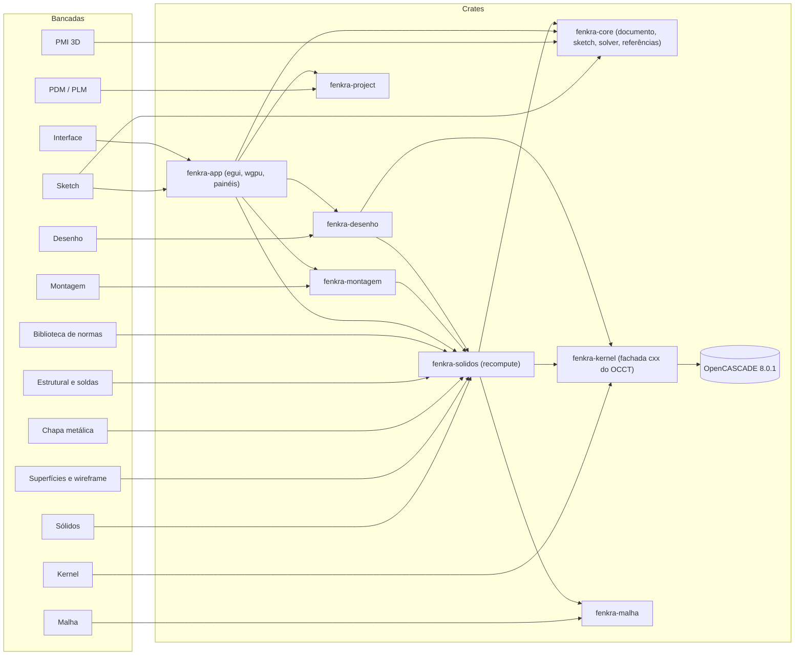
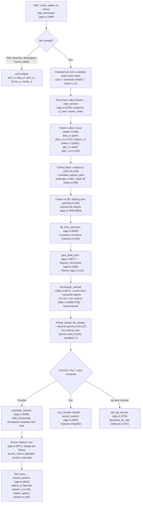
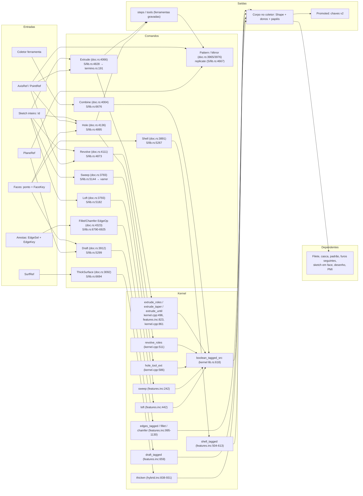
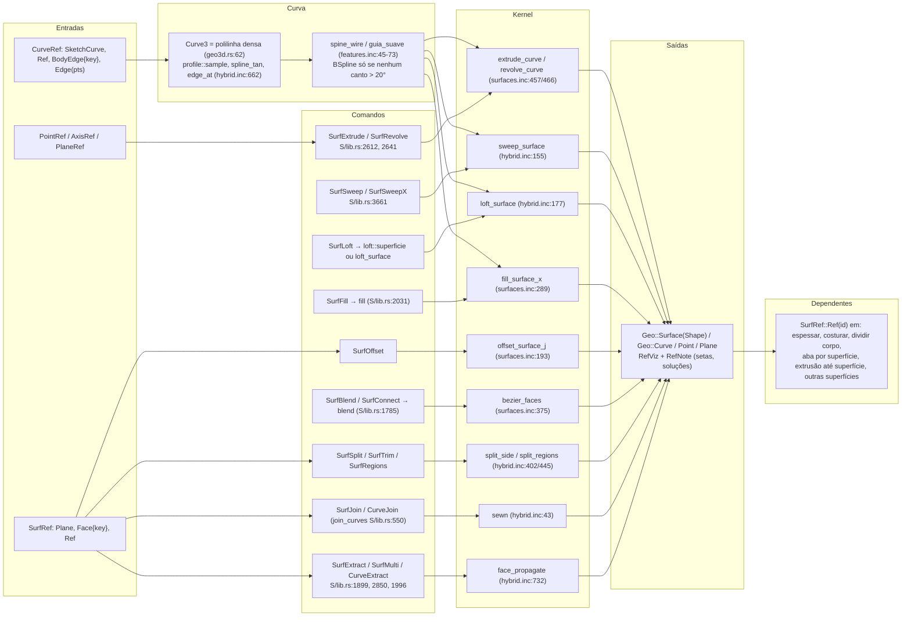
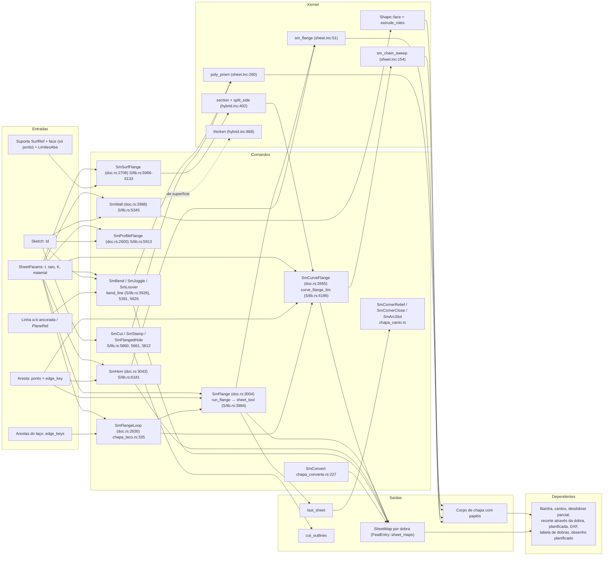
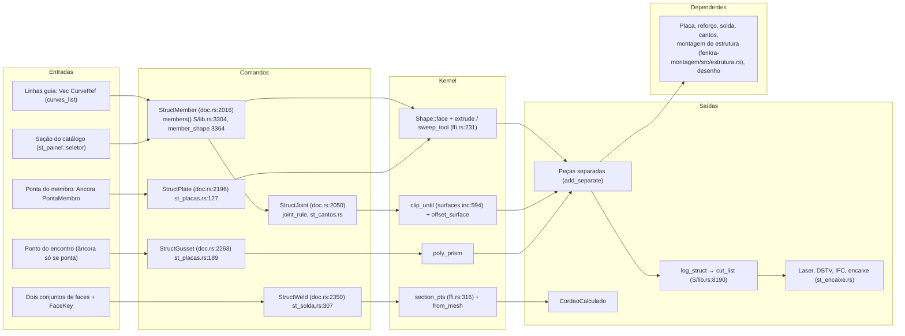
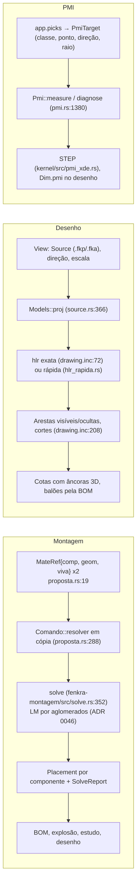
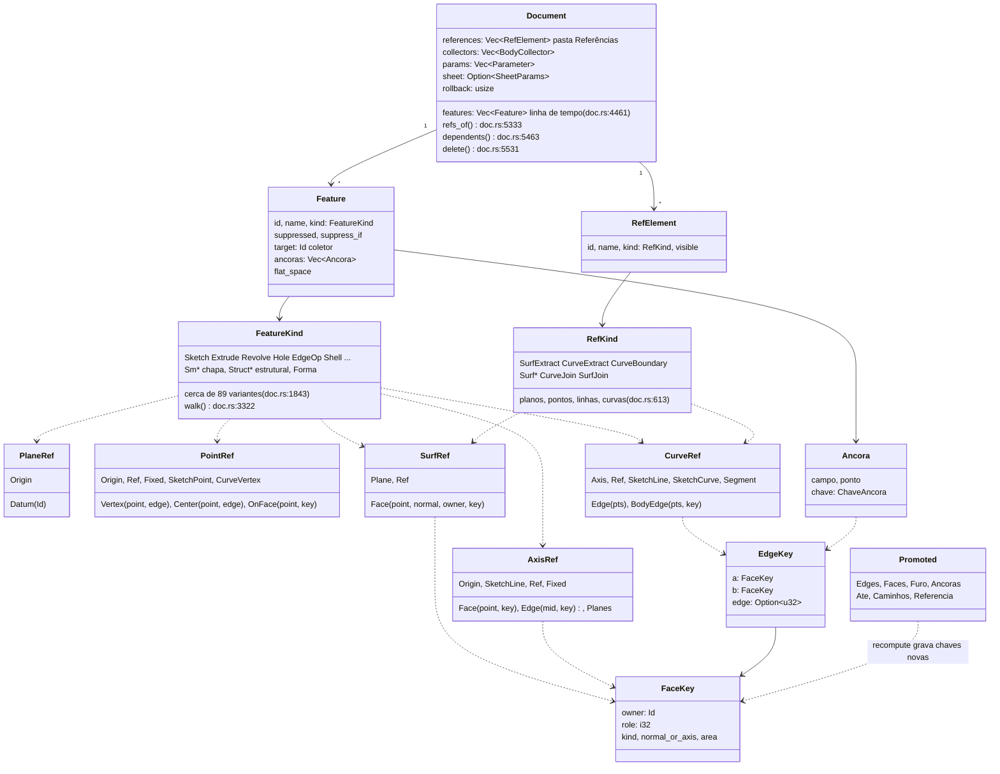
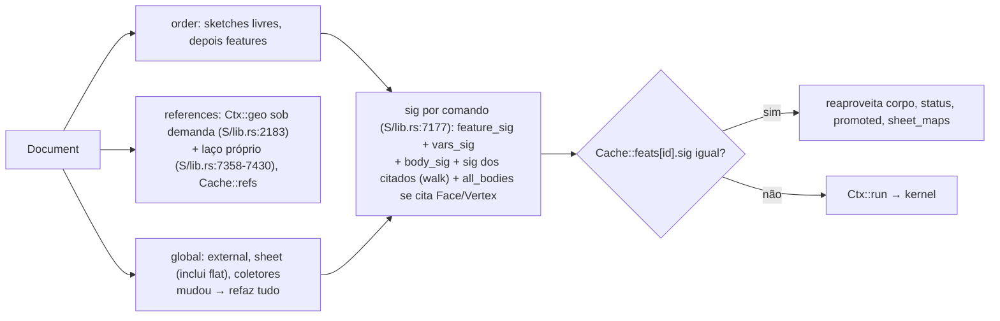

# Grafo do Fenkra

Mapa navegável de como o Fenkra se organiza: bancadas, crates, ciclo de um comando, comandos por bancada
(entradas, motor, saídas, dependentes) e o modelo do documento. Fonte: os mapas de 21/11/2026 em
[comandos/](comandos/) e a [auditoria de seleção](../benchmark/detalhe/selecao-auditoria.md). O contrato
que estes grafos devem passar a seguir é o [ADR 0107](adr/0107-contrato-de-feature.md).

Convenções: `arquivo:linha` é a linha da `develop` de 21/11 e muda a cada edição; a função é a âncora
estável. Arquivos sem pasta: `fenkra-app/src/` (interface), `fenkra-solidos/src/` (motor, `S/lib.rs`),
`fenkra-core/src/` (modelo, `doc.rs`), `fenkra-kernel/cpp/` (`*.inc`, `kernel.cpp`), todos em `crates/`.
O grafo de código gerado por AST (graphify, sem LLM) fica em `crates/graphify-out/` (fora do git).

Mantido pelo agente `arquiteto`: quem mudar um comando de forma que altere entradas, motor ou saídas
atualiza o mapa da bancada em `comandos/` e o grafo 3 aqui.

---

## 1. Bancadas → crates

| Bancada | Arquivos principais (domínio da skill) |
|---|---|
| Sketch | `fenkra-core/src/sketch.rs`, `fenkra-app/src/sketch_ui.rs`, `sketch_ext.rs`, `sketch_snap.rs` |
| Sólidos | `S/lib.rs`, `profile.rs`, `refs.rs`, `termino.rs`, `previa_leve.rs`; `features.inc`; `feat_ui.rs`, `editor.rs` |
| Superfícies | `geo3d.rs`, `loft.rs`, `regioes.rs`; `surfaces.inc`, `hybrid.inc`, `nurbs.inc`; `geo_ui.rs`, `sup3d.rs` |
| Chapa | `sheet.inc`; trechos de `S/lib.rs`, `chapa_*.rs`; `feat_ui.rs`, `chapa_*_ui.rs` |
| Estrutural | `structural.rs`, `st_*.rs`; `fenkra-montagem/src/estrutura.rs`; `st_ui.rs`, `st_*_ui.rs` |
| Montagem | `fenkra-montagem/src/` (`solve.rs`, `kin.rs`, `proposta.rs`, `bom.rs`); `asm_ui.rs`, `asm_cmd.rs` |
| Desenho | `fenkra-desenho/src/`; `drawing.inc`; `dwg_ui.rs` |
| PMI | `fenkra-core/src/pmi.rs`; `pmi_ui.rs`, `pmi_draw.rs`; `kernel/src/pmi_xde.rs` |
| Biblioteca | `biblioteca.rs`, `hardware.rs`, `fixadores.rs`, `engrenagens.rs` |
| PLM | `fenkra-project/src/` |
| Interface | `toolbar.rs`, `theme.rs`, `icons.rs`, `i18n.rs`, `picking.rs`, `render.rs`, `campos.rs`, `caixa_selecao.rs` |
| Kernel | `fenkra-kernel/src/lib.rs`, `ffi.rs`, `cpp/kernel.cpp`, `cpp/*.inc` |

---

## 2. Ciclo de vida de um comando

Pontos que o ADR 0107 muda neste ciclo: E passa a vir do descritor (uma regra só); F e G viram um caminho
só para 3D e árvore; L passa a esperar o resultado e não fechar em falha; I ganha rollback em `Err`.

---

## 3. Comandos por bancada: entradas → motor → saídas → dependentes

Leitura: cada caixa de comando mostra o `FeatureKind`/`RefKind` e a âncora do motor; a seta para o
kernel cita a função C++ (arquivo `.inc`). Saídas e dependentes à direita.

### 3.1 Sólidos

### 3.2 Superfícies e wireframe (`RefKind`, pasta Referências)

O nó "Curva" é o ponto do B559: a polilinha densa entre a entrada e o kernel. O ADR 0107 (seção 4) troca
por curva exata.

### 3.3 Chapa metálica

A aba por superfície reaproveita `curve_flange_lim` depois de cortar o suporte pelo plano da web; a OML
sai como polilinha de ~200 pontos (causa provável do facetado do B559 na chapa).

### 3.4 Estrutural e soldas

### 3.5 Montagem, Desenho e PMI (ciclos próprios)

---

## 4. Documento e referências

Chaves v2 (ADR 0010): a face é reencontrada por **dono** (comando que a criou) → **papel** (tampa 0,
final 1, lateral 2+i, `PAPEL_SUPERFICIE + i`) → **assinatura** (tipo, normal ou eixo, área) → ponto
clicado só como reserva (`refs::find_face`/`find_edge`, refs.rs:205/225). Se não sobra exatamente uma
entidade, o comando vai a erro com sugestão (`Ctx::resolve_faces`, S/lib.rs:3440). Os papéis nascem em
`extrude_roles`/`revolve_roles`, `boolean_tagged_src` e `papeis.rs`.

Hoje a chave é guardada de cinco jeitos (listas paralelas, `*_key`, dentro do `*Ref`, `Feature::ancoras`,
`RefKind{key}`); o ADR 0107 (seção 1) unifica num só.

