# Design review — slides (texto extraído)

Extraído de `Contextos e deisgn review.pptx` (58 slides). Texto como o usuário escreveu; imagens em `review/`.
Itens do backlog citam o slide de origem como `DR-NN`.

## DR-01

Fazer um benchmarking com catia V5 e olhar as evoluções do solidworks
Dinamismo do fusion 360

## DR-02

A rosca modelada está bugando, gerar um preview
E quando encerrado o comando ele realmente gere no 3D
Isso para todos os comandos
Casca não está funcionando na spline
E quando tem um furo escareado/ ou de outros tipos
E a spline não consegue achar a tangencia em outros elementos
Do sketch só nela mesma

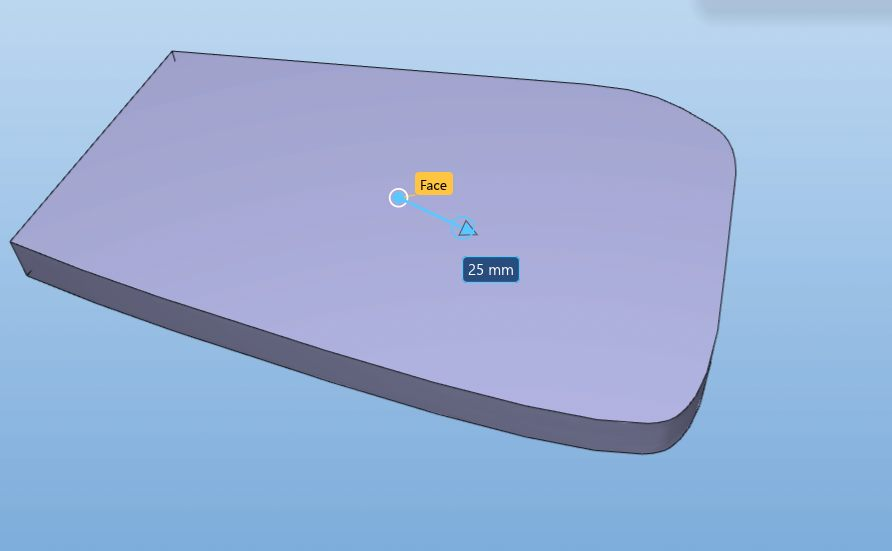
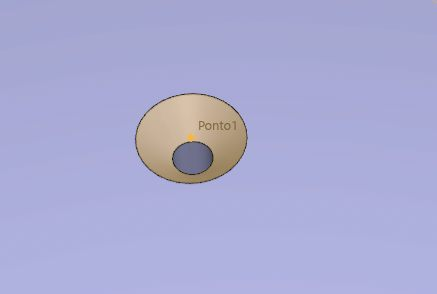

## DR-03

O Raft não funcionou em superfícies complexas de sólidos
Fazer rosca ficou ligado apenas a norma, mas poderia ser personalizável o pitch, perfil e tamanho, o tap está bem bugado, o do furo está legal
Importante colocar para estender o recorte, pois a rosca começa do meio, seria legal ter de onde começa a geração e também de te um chanfro incial para não ficar diretamente plano

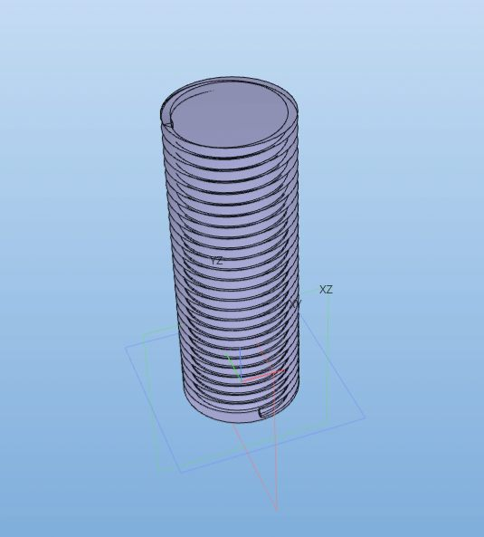
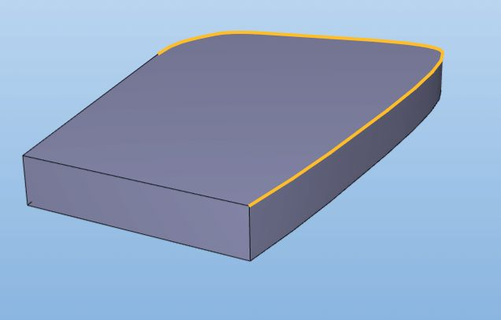
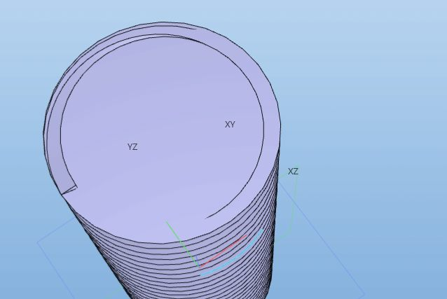

## DR-04

O plano na curva pode ser terferencia em relação a um ponto contigo nela, ou caso não contido projetado nela

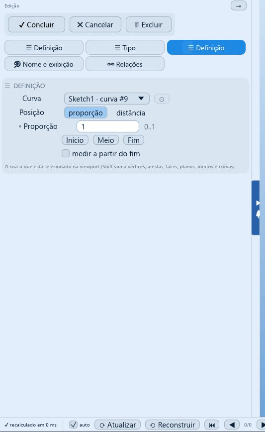

## DR-05

No sketch, não tem aquele tipo de seleção arrastando
Para esquerda e direita, e quando você clica na sombra
Ele deveria selecionar todos elementos que fazem parte daquela sombra
Na nervura não tem oção de parede fina para ambos lados ou seleção de lado

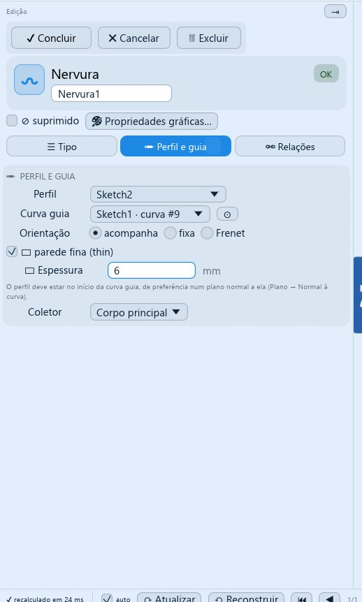
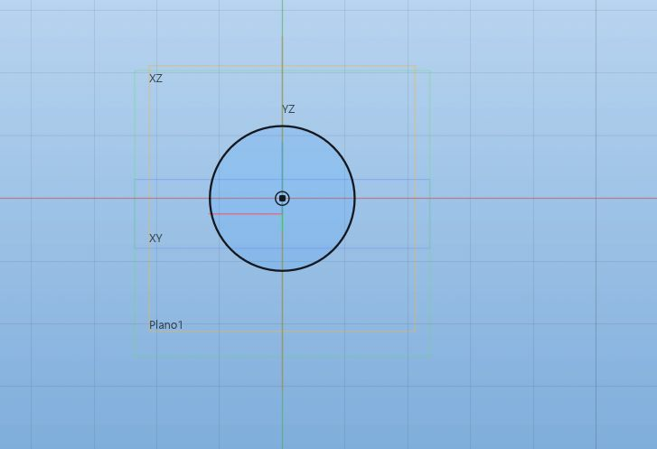

## DR-06

Ele não conseguiu fazer uma intersecção correta no sketc com perfis em outro
Elemento em outro plano, checkar
Não consigo fazer interesção dessas curvas com esses o plano que corta no meio

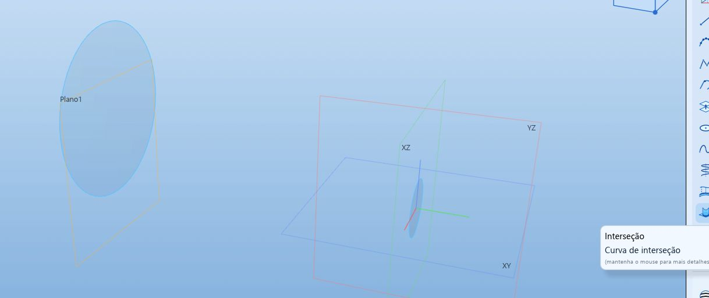
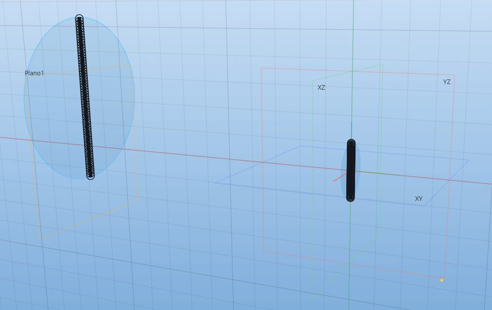

## DR-07

O loft não tem o menu interativo com coletor de corpos e multiplaseleciton
Deveria ter restrição incial e final baseada em um elemento e com controle de
Tensão de concordância
Casca para fora, gerou um raio, mas não tem opção de gerar reto, isso aí percebi que é da lógica, poderia implementar em todos os recurso que cria um “offset” o meio que ele vai simplificar para tornar possível aquela operação, se vai trimar, deixar reto ou com algum raio e permitir editar.

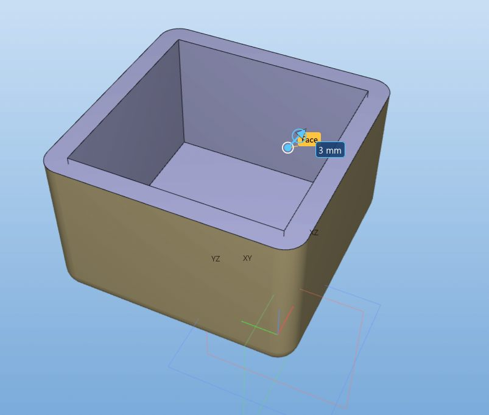
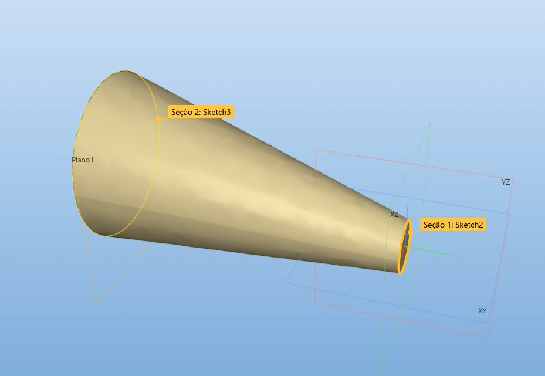

## DR-08

Essas linhas em vermelho na renderização da peça fica muito esquisito, remover, quando tem curvas também faz, o idela é ser chapado, igual é no sem arestas, só que com as arestas principais feitas

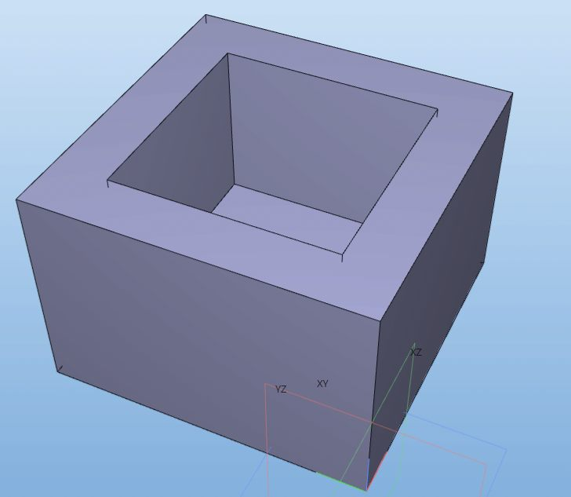

## DR-09

Ao criar um recurso que pede uma direção, pode ter a opção de criar normal a um plano selecionável ou normal a uma superfície

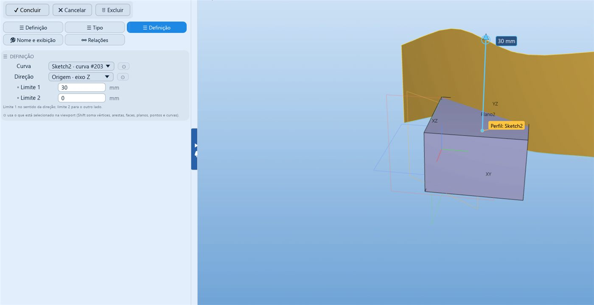

## DR-10

Ao aplicar filetes em supercíeis
Ou em faces, ele buga a renderização
Verificar se tem outro meio de calcular as arestas
Até as suaves, somente quando não for de curvatura
Se for tangente manter a aresta

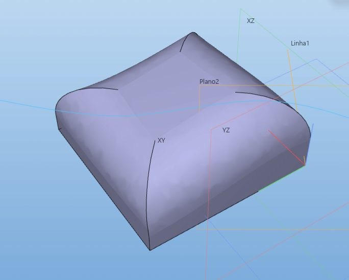

## DR-11

Alterei o perfil que estava cortando um cubo, e o filete se perdeu
A ideia é aquele sólido ter todo o registro fixo dos seus elementos e ser um ID
Essa filosofia deve ser em todos os comandos, para ficar ligado aquela aresta ou aquele ponto
E se por algum acaso aquela referencia mudar, ele com esse caminho e hierarquia de referencias ele reanexar
Automaticamente, se não conseguir mostrar erro e assistente de reparo

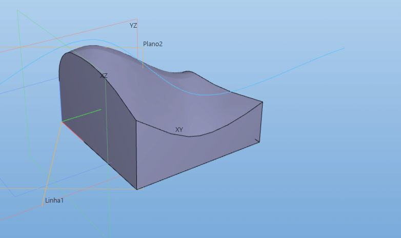

## DR-12

O engrossar não funcionou em uma face
de sólido
Não funcionou e não vi utilidade no
Modelagem sólida

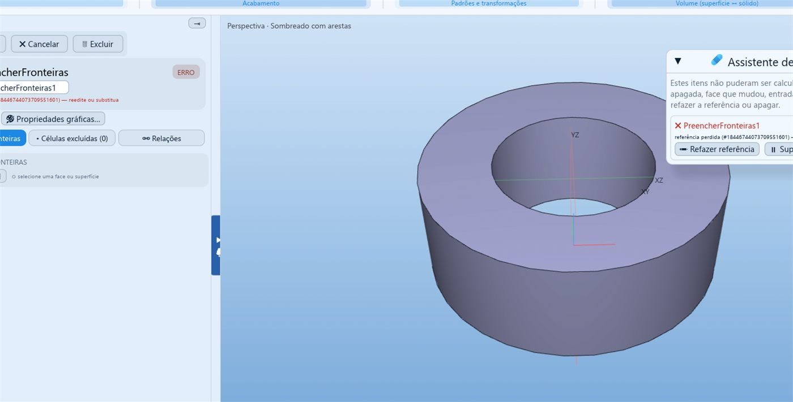
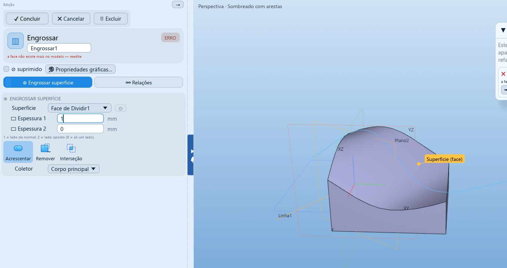

## DR-13

O fill não tem opção de fazer um preenchimento por sketch e dentro dele não tem como selecionar
Um quadrado (4linhas) para fechar uma curva para ele considerar uma curva, podia ter esse arvore de seleção
Em cadeia ( isso tem todas features )
O Join não funcinou para eu tentar junta 4 linhas, só faces e superfícies, os elementos são diversos que posso fazer o join
O preencher fronteiras e o preenchumento não funcionaram com o sketch isso quebra o workflow simples
Próximo PPT ajudará com extract e ele deve funcionar dentro de outras features como botão direito

## DR-14

r = 0.98 → tolerância padrão do modelo
r baixo → aceita grandes descontinuidades
Disponível apenas para:
Curvature continuity
🧮 4. Outputs (saídas)
4.1 Novo elemento geométrico
O comando gera:
Extract.xxx (para extrair um único elemento)
Multiple Extract.xxx (para extrair vários elementos)
Esse novo feature:
Aparece no spec tree
É independente do elemento original
Pode ser usado como entrada para outros comandos (offset, split, trim, loft etc.)
4.2 Elementos colocados em “No Show”
Alguns comandos criam contextual extracts automaticamente, que ficam ocultos. Exemplo: Parallel Curve → Create Extract (in point/tangency)
🛠️ 5. Ferramentas e comportamentos internos
5.1 User Selection Filter
Se estiver ativado:
Intersection edges activation
Tangent intersection edges activation
O CATIA automaticamente ativa:
Geometrical Element Filter
E ajusta o tipo de propagação conforme o filtro. Ao confirmar o comando, o filtro volta ao estado normal.
5.2 Complementary Mode
Permite selecionar “o inverso” da seleção atual.
Útil para extrair tudo exceto o que foi clicado.
Desativado para pontos e volumes.
5.3 Federation (Multiple Extract)
Agrupa células extraídas conforme sua conectividade.
Útil para superfícies com múltiplas regiões desconexas.
📌 6. Quando usar cada tipo de propagação
📘 7. Exemplos práticos
7.1 Extrair uma borda suave de uma superfície
Selecionar a aresta
Propagation: Tangent continuity
Ajustar Angular Threshold para 1° → Extrai toda a borda contínua sem quebras.
7.2 Extrair segmentos desconexos de uma curva composta
Multiple Extract
Complementary Mode → Seleciona automaticamente os segmentos não marcados.
7.3 Extrair apenas um segmento específico
No propagation → Ignora continuidade e parâmetros.
O comando Extract serve para extrair sub‑geometrias de elementos complexos, como:
Curvas compostas por vários segmentos
Superfícies com múltiplas regiões
Sólidos com múltiplos volumes
Bordas de faces
Pontos específicos
Ele cria um novo elemento geométrico baseado na seleção e nas regras de propagação.
🎯 2. Inputs (entradas)
O usuário fornece:
2.1 Elemento selecionado
Pode ser:
Curva
Ponto
Superfície
Face
Aresta
Volume
Sólido
A seleção pode ser:
Simples (um elemento)
Múltipla (vários elementos) → via Multiple Extract
2.2 Tipo de propagação
Define como o CATIA continua a extração além do elemento selecionado:
Point continuity Extrai elementos conectados por continuidade de ponto (C0).
Tangent continuity Extrai elementos conectados por continuidade de tangência (C1).
Curvature continuity Extrai elementos conectados por continuidade de curvatura (C2).
No propagation Extrai somente o elemento selecionado.
2.3 Parâmetros adicionais (somente para curvas)
Aparecem ao clicar Show Parameters >>:
Distance Threshold Intervalo: 0.001 mm a 0.1 mm Controla a distância máxima entre sub‑elementos para serem considerados conectados.
Angular Threshold Intervalo: 0.5° a 5° Controla a diferença angular máxima entre segmentos para serem considerados contínuos.
Curvature Threshold Intervalo: 0 a 1 Controla a diferença de curvatura permitida para suavizar descontinuidades.
2.4 Opções especiais
Complementary Mode Inverte a seleção: seleciona o que não foi selecionado e desmarca o que foi marcado. (Não funciona para pontos ou volumes.)
Federation (Multiple Extract) Agrupa células extraídas conforme sua conectividade.
⚙️ 3. Parâmetros explicados em profundidade
3.1 Distance Threshold
Usado para determinar se dois segmentos estão “próximos o suficiente” para serem considerados parte da mesma extração.
Default: 0.1 mm
Se o usuário definiu Merging Distance diferente de 0.001 mm, o valor inicial muda.
Disponível para:
Point continuity
Tangent continuity
Curvature continuity Não disponível para No propagation
3.2 Angular Threshold
Define se a mudança de direção entre dois segmentos ainda é considerada contínua.
Default: 0.5°
Disponível para:
Tangent continuity
Curvature continuity
3.3 Curvature Threshold
Define se a diferença de curvatura entre dois segmentos ainda é aceitável para continuidade C2.
A regra é:
Onde:
Rho1 = vetor de curvatura antes da descontinuidade
Rho2 = vetor de curvatura depois
r = valor definido pelo usuário (0 a 1)
Interpretação:
r = 1 → curvatura totalmente contínua

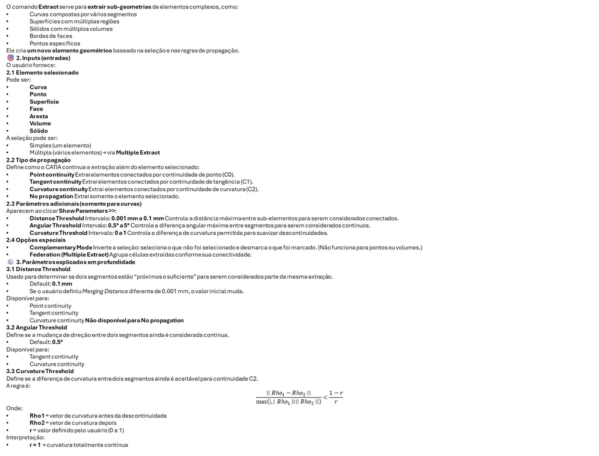

## DR-15

A origem vc tem que abrir o menu para dar hide
Permitir dar hide em todos esses menus nele mesmo
Origen external ref puc
Pmi e captures
parameters

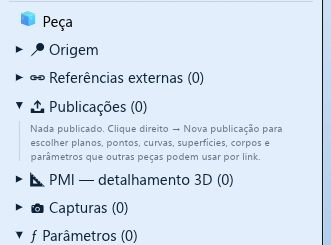

## DR-16

Ter a opção desse distância final e inicial juntas

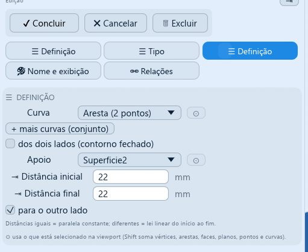

## DR-17

Não gerou por linha em spline, realizar a melhoria junto com o detalhamento txt

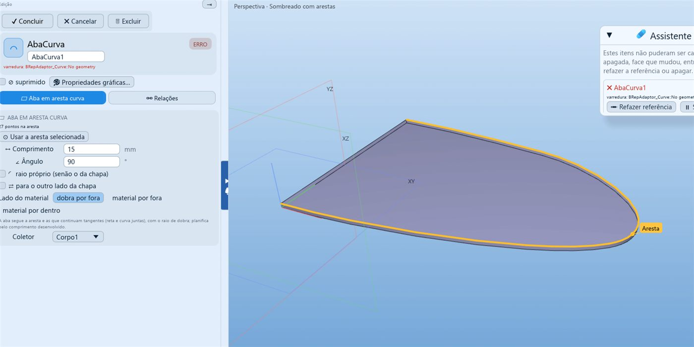
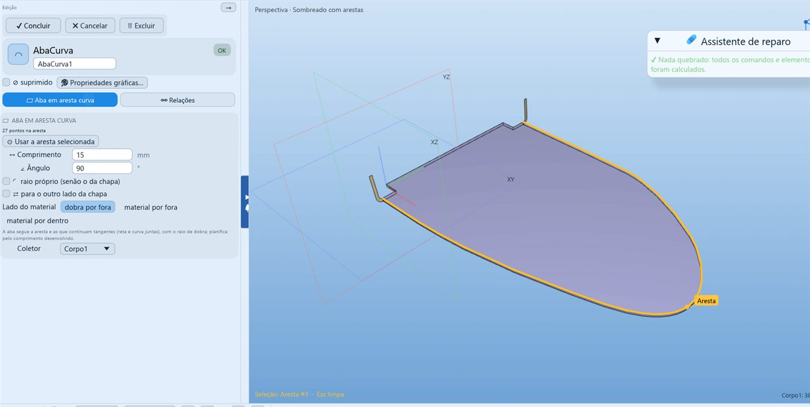

## DR-18

No sketch ter opção de selecionar geometrias externas ( que cria publicações automáticas ou no próprio desenho)
Ou não permitir seleções externas denstro do sketch

## DR-19

Aba com superfícies falhou completamente, gerou nada, verificar o Txt e tentar entender melhor, quero fazer
Uma nervura de asa e não consigo

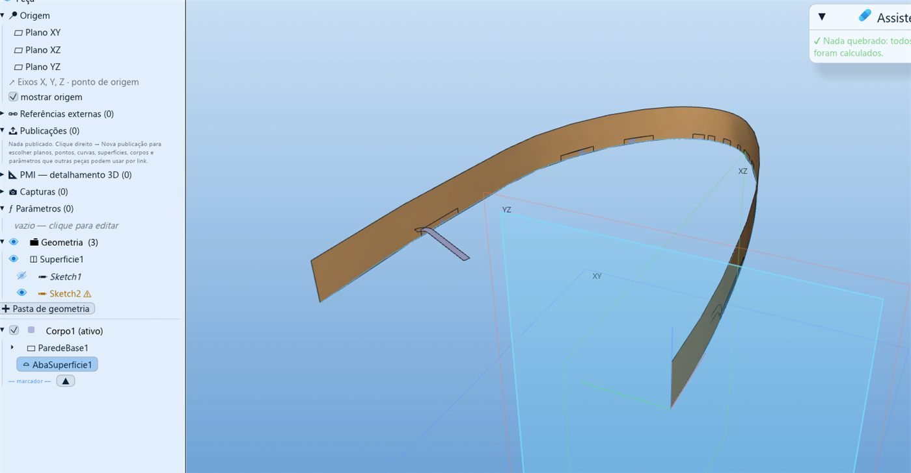

## DR-20

Aqui o recorte funcionou muito bem do dobrado para o desdobrado, o inverso bugou, também por causa
que pegou no raio de dobra e devia funcionar mesmo no raio de dobra

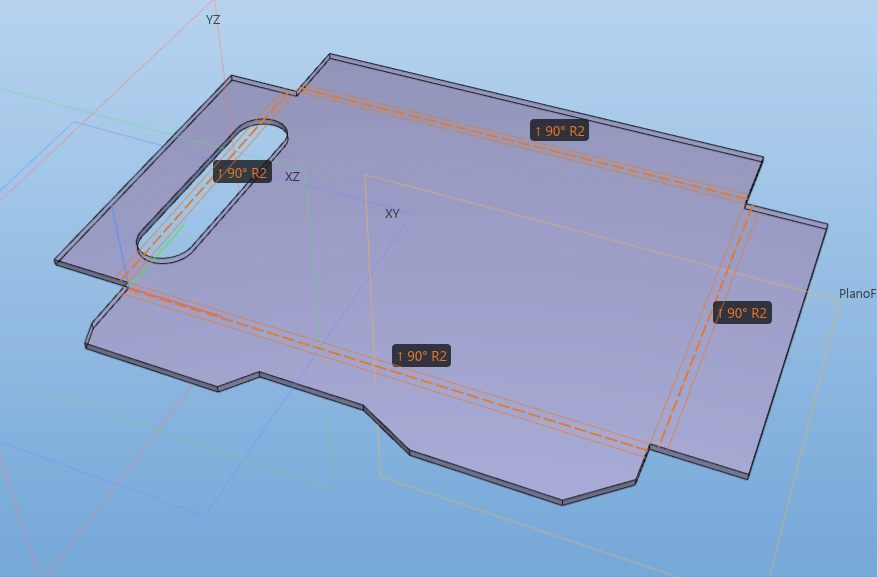
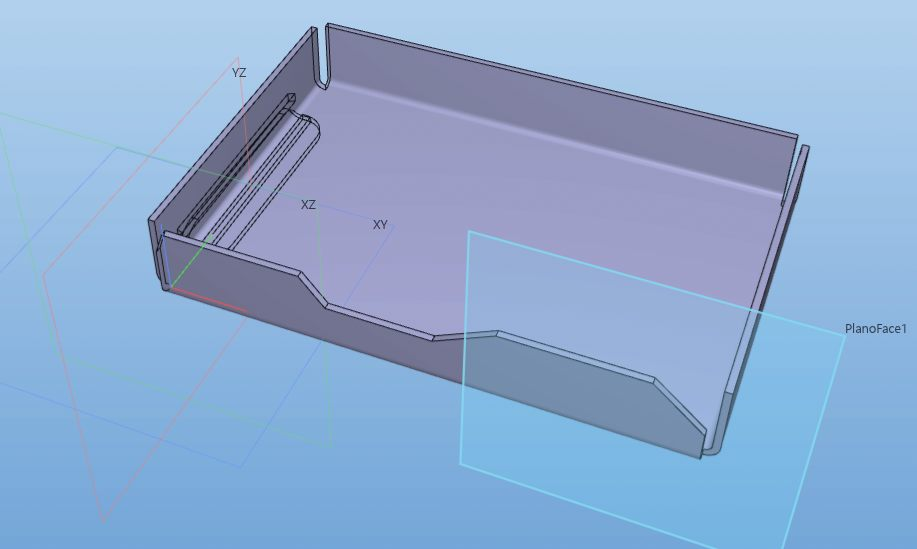
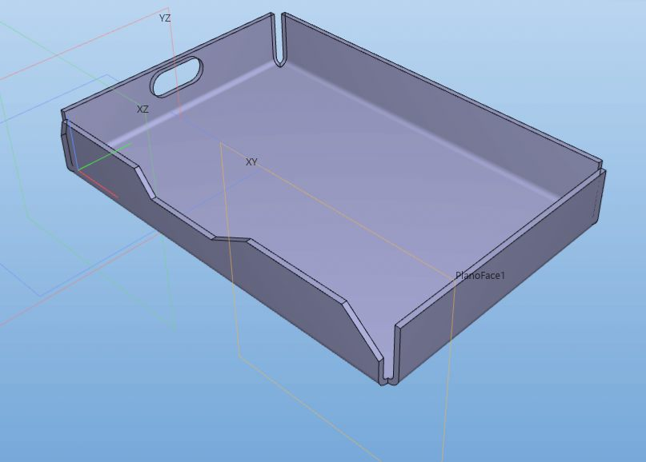

## DR-21

Planos de faces ainda estão meio bugados e não parametrizados, quando deleto a face o plano de face ainda fica
Lembrar de toda filosofia de ser parametrizado pelo nome daquele recurso/face/vértice/linha, mesmo que seja
Subpartes daquele elemento

## DR-22

Aba por linha não funcionou, não emendeu os raios

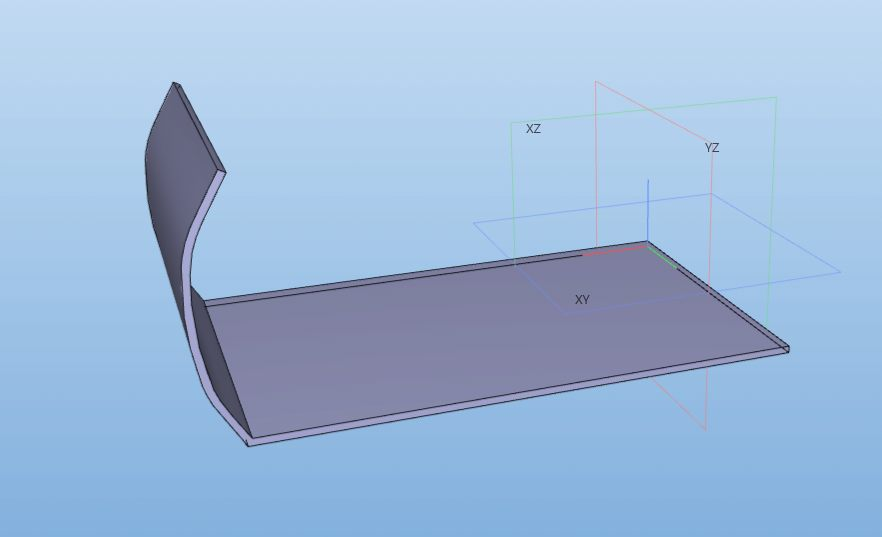

## DR-23

Abas com superfícies não funcionou

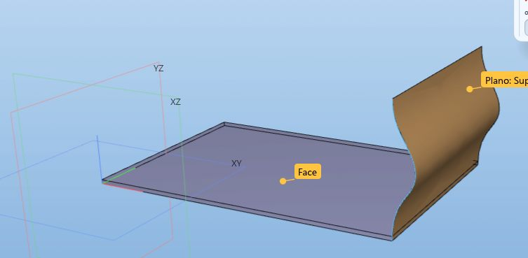

## DR-24

Superfícies de um modo geral quando tem extensões devem ter o Up to Element

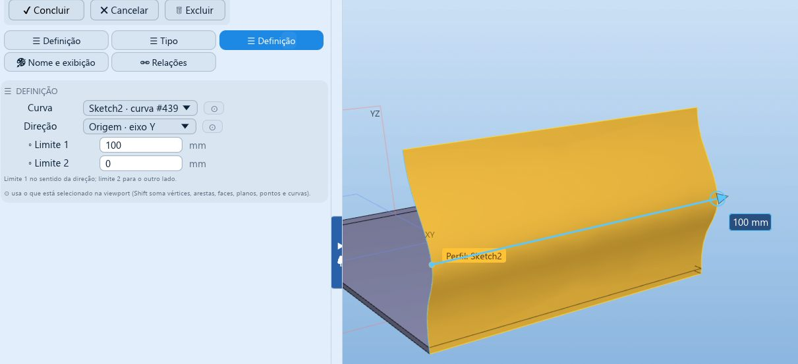

## DR-25

2. Filosofia central: primeiro o suporte, depois o modo, depois o refinamento
Quase todos os comandos seguem essa ordem:
Escolha do suporte
Sketch, curva, superfície, face, plano, eixo.
Escolha do modo de operação
Dimensão fixa, até elemento, até próximo, até último, com guia, com spine, com duas guias, etc.
Escolha dos parâmetros numéricos e qualitativos
Comprimento, ângulo, raio, continuidade, tolerância, direção, lado, propagação.
Escolha das opções avançadas
Simplificação, extrapolação, propagação C1/C2, tangência, curvatura, modo de trim, modo de join, healing, etc.
Essa filosofia é consistente:
Suporte define o “onde”
Modo define o “como”
Parâmetros definem o “quanto”
Opções avançadas definem o “quão refinado”
3.1 Parâmetros de extensão / limite
Usados em:
Pad, Pocket, Shaft, Groove, Rib, Slot
Extrude, Sweep, Extrapolate, Offset, Fillet, Draft
São coisas como:
Length / Depth / Height
Up to Next / Up to Last / Up to Plane / Up to Surface
Symmetric / Reverse / Both Sides
Filosofia aqui:
Você escolhe se quer controle absoluto (dimensão fixa) ou controle relativo (até algo).
sempre tenta te dar um modo “inteligente” (Up to Next, Up to Last) para evitar valores fixos frágeis.

## DR-26

Usados em:
Pad, Pocket, Draft, Sweep, Offset, Fillet, Shell, Thickness
Incluem:
Direction (vetor, eixo, normal, tangente)
Side (lado 1, lado 2, ambos)
Reverse (inverter sentido)
Filosofia:
Primeiro você diz para onde a feature vai.
Depois você diz de que lado ela atua.
Fill, Blend, Multi-Section Surface, Fillet, Sweep
Part Design: Fillet, Draft, Shell (indiretamente)
Incluem:
C0 (posição)
C1 (tangência)
C2 (curvatura)
Filosofia:
C0 é o mínimo: encostar.
C1 é o padrão técnico: suave o suficiente para peças mecânicas.
C2 é o padrão estético: suave o suficiente para classe A (automotivo, aero).

## DR-27

3.4 Parâmetros de propagação
Usados em:
Extract, Multiple Extract, Fillet, Chamfer, Draft, Shell, Offset, Join
Incluem:
Tangency propagation
Curvature propagation
Connected propagation
Federation / Complementary
Filosofia:
Você escolhe se quer atuar só na face/curva selecionada ou em todas as conectadas.
Isso é crítico em superfícies complexas: um fillet pode se propagar por toda a peça se você deixar.
Join, Extract, Intersection, Offset, Healing, Smooth, Extrapolate
Incluem:
Tolerância de distância
Tolerância angular
Simplify / No simplify
Merge / No merge
Filosofia:
sabe que geometria real nunca é “perfeita”.
Ele te deixa escolher quão agressivo ele pode ser ao “limpar” a geometria.
Tolerância alta → mais simples, menos fiel.
Tolerância baixa → mais fiel, mais complexa.

## DR-28

Quando você clica numa feature:
Pré-preenche parâmetros com defaults “seguros”
Ex.: Pad com 20 mm, Fillet com 2 mm, Draft com 3°.
Te mostra o preview dinâmico
Você vê o efeito antes de confirmar.
Te deixa alternar entre modos
Dimensão ↔ Up to Next ↔ Up to Last ↔ Up to Plane ↔ Up to Surface.
Te deixa entrar em “Advanced”
Onde você controla continuidade, propagação, tolerância, simplificação.
Essa filosofia é sempre a mesma:

## DR-29

Quando o menu é muito curto, ao invés de ter abas
Ter caixas com cada comando mestre daquela feature
Agora se ele ficar muito longo pode colocar em abas para organizar

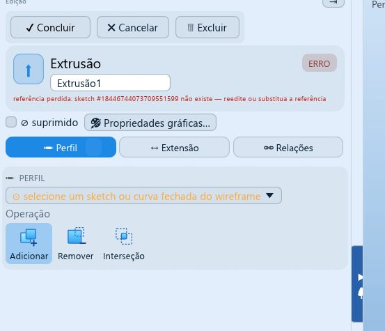

## DR-30

A parte de esconder está bem travada e não segue a ordem hierárquica
3. Hierarquia: Hide em pai afeta filhos
Esse é um ponto crucial.
Quando você dá Hide em:
Um Body (Part Design)
Um Geometrical Set (GSD)
Um Hybrid Body
Um Product (Assembly)
:
Esconde todos os elementos filhos daquele nó.
Mesmo que individualmente eles estivessem em “Show”.
Ou seja:
Hide no pai = Hide em tudo que está dentro dele (graficamente).
Mas o estado individual de cada filho (se estava Show ou Hide) continua guardado internamente.
Quando você dá Show no pai:
Os filhos voltam a seguir seus próprios estados:
Quem estava Show volta a aparecer.
Quem estava Hide continua escondido.
Isso é importante pra entender que:
Hide/Show é hierárquico e local ao mesmo tempo.

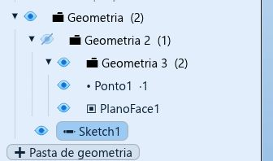

## DR-31

Na montagem também deve ter origem e as peças ainda não estão 100% editáveis na montagem vendo as
Outras peças
Quando estou criando PMI, o highlight está bugando, fazer um menu

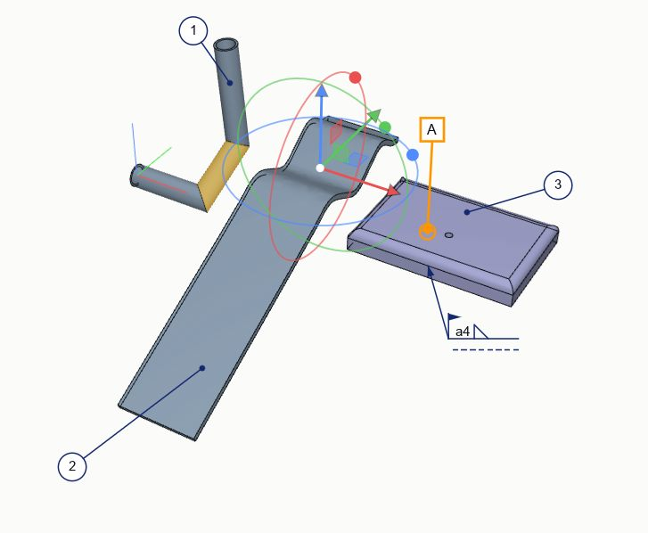

## DR-32

No geral o menu de edição do montagem ainda não segue a filosofia de seleção
Dar hide, delete, seleção com alt e Ctrl

## DR-33

Os balões automáticos não estão funcionando quando o item é estrutural ( gera lista de corte )
No PMI 3D, deveria gerar, ou ter uma opção de gerar montagem a partir de módulo estrutural
Aí ele é vira um arquivo Pai que transformas os membros (ele deve reconhecer os iguais e criar 1 peça só deixar instância
Amarrada ao estrutural Pai talvez por links, isso para gerar PMI 3D para cada peça ou detalhes de notas para cada detalhe e também para detalhamento folha a folha com link de parâmetros da peça para
fazer as peças via corte a plasma/laser
Isso serve para o 2D e para 3D

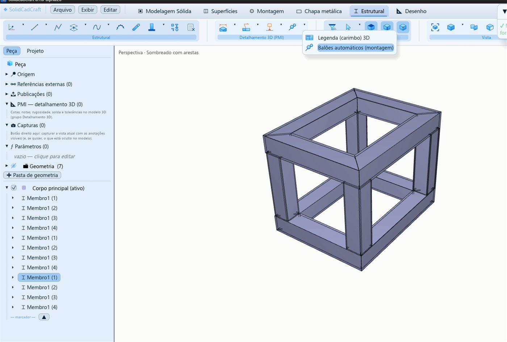

## DR-34

3.1 Um plano de projeção
Baseado em:
Plano XY
Plano YZ
Plano ZX
Ou qualquer plano que você escolher
3.2 Um sistema de coordenadas da vista
Inclui:
Origem da vista
Direção de projeção
Orientação da vista
Escala da vista
3.3 Um “snapshot” paramétrico do 3D
O CATIA registra:
Faces
Arestas
Curvas
Sólidos
Superfícies
Sketches visíveis
Estado de Hide/Show
Estado de Update do 3D
Esse snapshot é dinâmico — não é estático
6. cria a “View Frame” (estrutura da vista)
A vista não é só linhas — ela tem estrutura:
Caixa da vista
Nome da vista
Escala
Orientação
Setas de corte (se houver)
Rótulos automáticos
Se você alterar o 3D:
marca vistas como “não atualizadas”
Linhas podem ficar vermelhas
Cotas podem ficar amarelas
Hachuras podem desaparecer
Símbolos podem deslocar
Você deve clicar:
Update
Ou ativar:
Automatic Update

## DR-35

Propriedades internas (2D)
Propriedades herdadas do 3D
Propriedades herdadas da vista
Propriedades herdadas da norma (ISO/ASME)
Isso cria um sistema de propriedades hierárquico, onde:
A vista controla o estilo geral O 3D controla a geometria O elemento controla sua aparência A norma controla o padrão final
Filosofia geral: cada elemento 2D tem propriedades próprias + propriedades herdadas do 3D

## DR-36

A vista é o elemento mais importante do 2D. Ela controla tudo que está dentro dela.
2.1 Propriedades geométricas
Orientation (frontal, lateral, superior, isométrica)
Projection type (first angle / third angle)
Scale
View plane
Direction of projection
Cutting plane (se houver corte)
2.2 Propriedades gráficas
Line thickness
Line type (contínua, tracejada, oculta)
Color
Hachura
Tangency display (mostrar/ocultar tangências)
Hidden lines (mostrar/ocultar)
2.3 Propriedades de atualização
Associativity (ligação com o 3D)
Update status (atualizada / desatualizada)
Broken links (perda de referência)
2.4 Propriedades de dependência
Vista pai
Vistas projetadas
Vistas de detalhe
Vistas de corte

## DR-37

🟧 3. Propriedades das Linhas (Edges, Curves, Contours)
Cada linha no 2D tem propriedades específicas:
3.1 Propriedades geométricas
Tipo de linha
Contorno
Oculta
Tangente
Interseção
Borda de superfície
Borda de sólido
Origem 3D
Face
Aresta
Curva
Sketch
Superfície
3.2 Propriedades gráficas
Espessura
Cor
Tipo de traço
Prioridade de exibição
3.3 Propriedades de dependência
Associatividade com o 3D
Dependência da vista
Estado de visibilidade
Estado de corte
3.4 Propriedades normativas
ISO: tangências exibidas
ASME: tangências ocultas
DIN: estilos específicos

## DR-38

4. Propriedades das Hachuras (Section Hatching)
Hachuras são geradas automaticamente em cortes.
4.1 Propriedades geométricas
Material (pode definir padrão)
Ângulo
Espaçamento
Região da seção
Limites da seção
4.2 Propriedades gráficas
Cor
Tipo de hachura
Espessura
4.3 Propriedades de dependência
Associatividade com o corte
Atualização automática
Dependência da vista
5. Propriedades das Cotas (Dimensions)
As cotas são os elementos mais ricos em propriedades.
5.1 Propriedades geométricas
Valor
Unidade
Tolerância
Precisão
Tipo (linear, angular, radial, diametral)
Referência 3D (se associativa)
5.2 Propriedades gráficas
Estilo de texto
Estilo de seta
Estilo de linha de chamada
Cor
Espessura
5.3 Propriedades de dependência
Associatividade com o 3D
Dependência da vista
Atualização automática
Estado de consistência (verde, amarelo, vermelho)
5.4 Propriedades normativas
ISO / ASME / DIN
Regras de tolerância
Regras de setas
Regras de posicionamento

## DR-39

Propriedades dos Símbolos (Annotations)
Incluem:
Rugosidade
Solda
Centro
Datum
GD&T
Notas técnicas
Propriedades
Texto
Estilo
Norma
Referência geométrica
Associatividade
Atualização
. Propriedades dos Cortes (Section Views)
Um corte tem propriedades próprias:
7.1 Propriedades geométricas
Plano de corte
Perfil de corte
Tipo de corte
Profundidade
Direção
7.2 Propriedades gráficas
Hachuras
Linhas de corte
Setas
Rótulos
7.3 Propriedades de dependência
Vista pai
Vista derivada
Atualização automática

## DR-40

Propriedades dos Detalhes (Detail Views)
8.1 Geometria
Região ampliada
Fator de escala
Posição da vista
8.2 Gráficas
Moldura
Rótulo
Estilo
8.3 Dependência
Vista pai
Atualização automática
1. Norma (ISO/ASME/DIN)
Define regras gerais.
2. Vista
Define estilo da vista.
3. Elemento 2D
Define estilo individual.
4. Propriedade herdada do 3D
Define geometria.
5. Overrides manuais
Você pode sobrescrever qualquer propriedade gráfica.

## DR-41

Cada elemento tem:
ID único
Referência ao 3D
Referência à vista
Referência à norma
Lista de propriedades gráficas
Lista de propriedades geométricas
Estado de atualização
Estado de visibilidade
Isso permite:
Atualização automática
Consistência entre vistas
Controle normativo
Parametrização
Robustez
Cada arquivo pode ter:
Sheet.1
Sheet.2
Sheet.3
… quantas você quiser.
Cada folha é independente, com:
Formato
Norma
Escala
Vistas
Cartucho
Background
Propriedades gráficas
Propriedades de impressão
Propriedades de exportação

## DR-42

Cada folha tem duas camadas internas:
2.1 Working View (View)
É onde você coloca:
Vistas
Cortes
Detalhes
Cotas
Símbolos
Anotações
Linhas 2D
É o ambiente de trabalho real.
2.2 Background View
É onde ficam:
Cartucho
Moldura
Logotipos
Informações fixas
Textos padrão
Tabelas fixas
A folha controla:
4.1 Espessura de linha padrão
Fina
Média
Grossa
4.2 Tipo de linha padrão
Contínua
Tracejada
Oculta
Tangente
4.3 Cor padrão
Preta
Azul
Cinza
Custom
4.4 Estilo de texto
Fonte
Altura
Peso
Justificação
4.5 Estilo de hachura
Ângulo
Espaçamento
Tipo
Cor

## DR-43

Propriedades de vistas dentro da folha
Cada vista dentro da folha tem propriedades próprias, mas também herda propriedades da folha.
A folha controla:
Escala padrão das vistas
Estilo de linha das vistas
Estilo de cotas das vistas
Exibição de tangências
Exibição de linhas ocultas
Exibição de hachuras
A folha controla:
6.1 Estado de atualização
Atualizada
Desatualizada
Com erros
Com links quebrados
6.2 Dependência do 3D
A folha sabe:
Qual peça está associada
Qual versão da peça
Se o 3D mudou
Se as vistas precisam ser recalculadas
6.3 Atualização automática
Você pode ativar:
Update automático
Update manual

## DR-44

Quando você cria um estrutural entende que:
A peça não é um sólido único, mas um conjunto de corpos estruturais.
Cada corpo é um perfil estrutural (tubo, cantoneira, barra, viga, etc.).
Cada corpo tem propriedades individuais (comprimento, perfil, massa).
O 2D deve refletir cada corpo separadamente, além da estrutura completa.
O desenho deve incluir lista de corte (Cut List).
O desenho deve permitir detalhamento individual de cada corpo.
Ou seja:
O 2D de Weldment é um híbrido entre desenho de peça e desenho de montagem.

## DR-45

2.1 Corpos estruturais (Structural Bodies)
Cada perfil é um corpo separado.
2.2 Cut List (Lista de corte)
Agrupa corpos por:
Tipo de perfil
Comprimento
Orientação
Identificação
Material
2.3 Propriedades de corpo
Cada corpo tem:
Comprimento
Perfil
Material
Peso
Identificador (Item nº)
3.7 Detalhar cada corpo individualmente
Vai permitir:
Criar vistas individuais de cada corpo
Criar cortes específicos
Criar detalhes de extremidade
Criar vistas de orientação do perfil
Criar vistas de corte para mostrar o formato interno
Isso é essencial para fabricação.
Isso serve para o 2D e para 3D

## DR-46

Para a gestão de peças de geometria, faltou a opção a adicionar os selecionados
Para uma pasta nova e abrir um menu de quem vai ser o pai e escolher, mas sempre colocar
Abaixo do pai atual com opção do usuário alterar

## DR-47

Anotação não deixar a seta ultrapassar
O próprio pmi e mudar a orientação

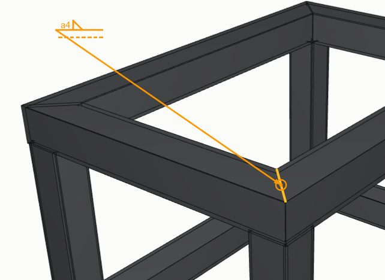

## DR-48

No PMI é importante ter como selecionar os elementos que aquela feature vai fazer o highlight
E também adicionar mais Leaders no 3D baseado nesses features selecionadas
Ser mais inteligente e ter mais opções de onde a leader sai nesse caso queria (exemplo a seta vermelho)

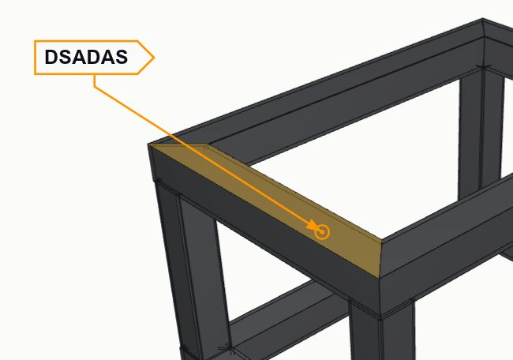

## DR-49

Na criação de pontos, no plano, coordenada ou na curva e outras opções
Tentar criar como trocar o referencial (acho que coloquei já isso) mas gerar as setas em 3D e mostrar
No 3D as cotas de referencia.

## DR-50

✔ Como funciona internamente
identifica todas as interseções da entidade selecionada.
Ele cria “segmentos virtuais” entre essas interseções.
Quando você clica, ele apaga somente o segmento onde o clique ocorreu.
Restrições associadas ao segmento removido são apagadas ou realocadas.
✔ Quando usar
Limpar perfis antes de fazer Pad / Pocket
Remover trechos internos de círculos
Criar cantos rapidamente
Ajustar perfis complexos
✔ Observação importante
O Trim não cria novos pontos — ele apenas remove trechos existentes.
Diferenças para o Trim normal
Não exige selecionar limites: basta passar o cursor sobre o trecho e clicar.
Funciona como uma “borracha inteligente”.
Pode quebrar elementos automaticamente quando necessário.
✔ Funcionamento interno
detecta automaticamente qual segmento está isolado pelo clique.
Ele apaga o trecho e reconstrói a geometria ao redor.
Mantém restrições sempre que possível.
✔ Vantagens
Extremamente rápido
Ideal para limpar sketches complexos
Funciona até em linhas isoladas, onde o Trim normal não funciona (confirmado na fonte)

## DR-51

Como funciona
Você seleciona um ponto ou referência.
cria novos nós (pontos) na geometria.
A entidade é dividida em segmentos independentes.
Cada segmento pode receber restrições separadas.
✔ Quando usar
Criar pontos de referência
Dividir curvas para aplicar restrições diferentes
Preparar perfis para operações como Trim, Fillet, Chamfer
TRIM EXTEND (Relimitation avançada)
Mostrado na fonte como ferramenta que estende ou corta até encontrar um limite
.
✔ O que faz
Estende uma linha até encontrar outra.
Corta uma linha até o limite mais próximo.
Funciona como “Trim + Extend” em uma única ferramenta.
✔ Funcionamento interno
CATIA projeta a direção da entidade.
Ele calcula a interseção com o limite mais próximo.
Ele ajusta o comprimento da entidade até esse ponto.
✔ Quando usar
Criar cantos automaticamente
Ajustar perfis sem precisar desenhar novos trechos
Conectar linhas que não se encontram

## DR-52

CLOSE ARC (Fechar arco)
Fonte confirma que Close Arc cria círculos completos a partir de arcos existentes .
✔ O que faz
Transforma um arco em um círculo completo.
✔ Funcionamento
identifica o centro do arco.
Ele cria o círculo completo mantendo o raio.
Restrições são preservadas.
Também citado na fonte como ferramenta para criar o arco complementar .
✔ O que faz
Cria o arco oposto ao arco selecionado (o “complemento” do círculo).
✔ Funcionamento
calcula o círculo completo.
Ele cria o arco que falta para completar o círculo.
Mantém o centro e o raio originais.

## DR-53

7. RELIMITATION (Conjunto completo de ferramentas)
Fontes mostram que Relimitation inclui: ✔ Trim ✔ Break ✔ Quick Trim ✔ Close Arc ✔ Complement
✔ O que é Relimitation?
É o grupo de ferramentas que altera limites de entidades no Sketcher.
✔ O que significa “paragem”?
No contexto do, “paragem” refere-se a limitar ou interromper uma entidade em um ponto específico — exatamente o que Break, Trim e Trim Extend fazem.
Com base nos vídeos analisados, o CATIA usa:
1. Interseções detectadas
Ele identifica automaticamente onde as entidades se cruzam.
2. Segmentos virtuais
Cada trecho entre interseções vira um “segmento”.
3. Segmento clicado
O trecho onde o usuário clica é o alvo da operação.
4. Restrições
Mantidas quando possível
Removidas quando o trecho é apagado
Recalculadas quando a geometria muda
5. Prioridade de limpeza
Quick Trim tem prioridade em remover trechos “internos” ou “isolados”.

## DR-54

Questões do sheetmetal devem ser vistas melhor conforme tudo que coloquei nesse ppt
E criar vários métodos de fazer e unificar em um comando só com tipo e ir abrindo os boxes abaixo
Bug em gerar flange na
Aresta com curva e reta

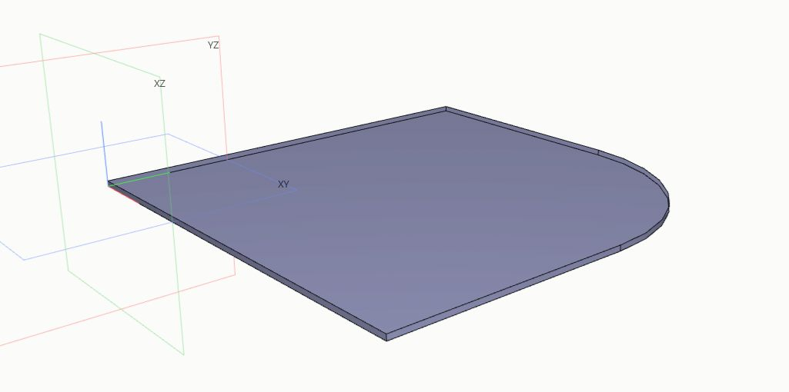
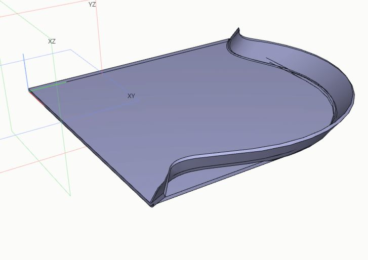

## DR-55

Dobras em sequencia estão bugando

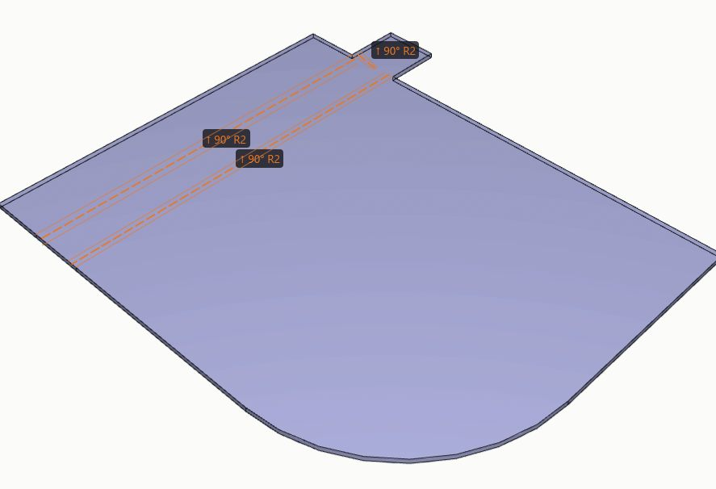
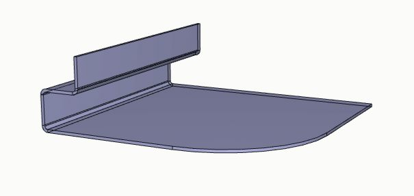

## DR-56

Bug com multipla dobras + outra lateral

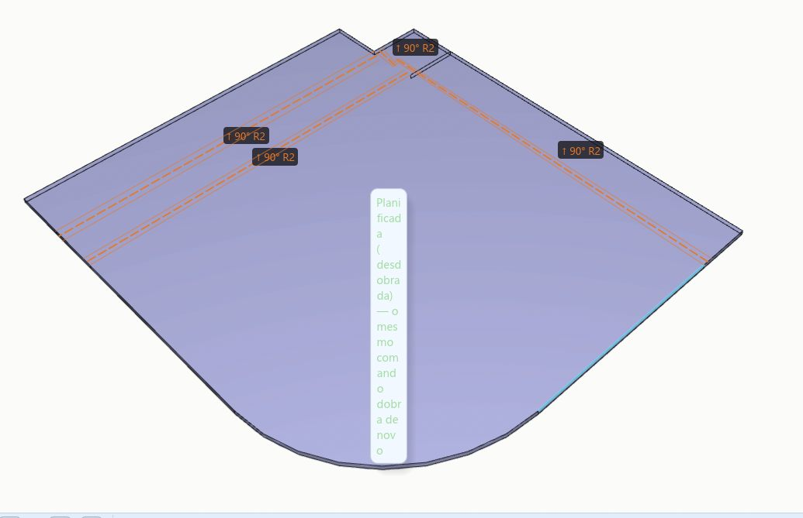
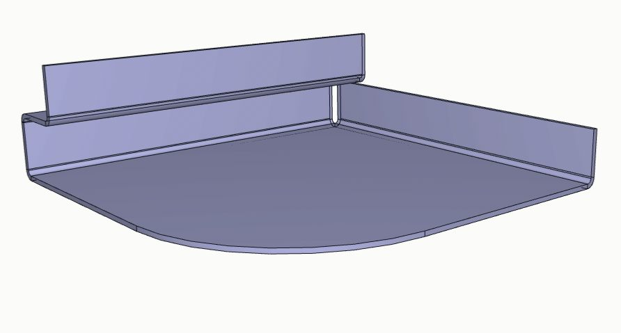

## DR-57

Duas abas compostas uma ao lado da outra buga muito, deveria ter uma validação dessas geometrias para ele não atritar entre abas

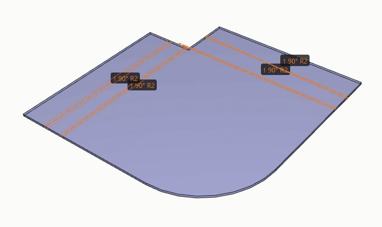
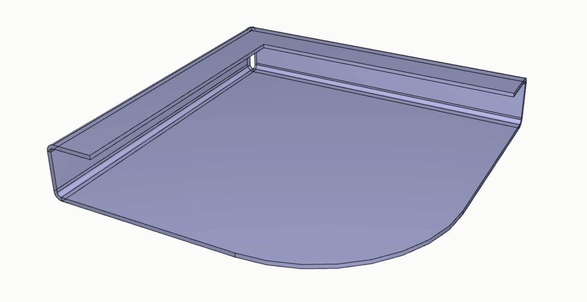

## DR-58

Projeto / VPM
